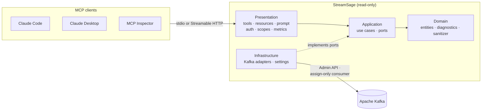
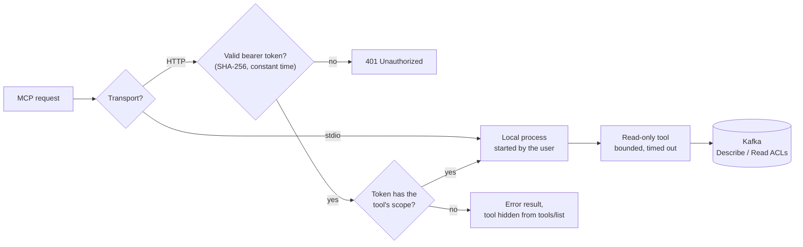

<div align="center">

# StreamSage

**AI-powered Kafka observability & troubleshooting MCP server**

Ask your AI assistant about your Apache Kafka cluster: topics, consumer lag,
stalled partitions, dead letter queues and messages. StreamSage answers with
evidence, never guesses, and **never writes to Kafka**.

[](https://github.com/FVitor7/streamsage/actions/workflows/ci.yml)
[](https://github.com/FVitor7/streamsage/releases)
[](pyproject.toml)
[](LICENSE)
[](https://modelcontextprotocol.io)

</div>

---

## What it looks like

> **You:** Which consumer group is furthest behind, and is it stuck?
>
> **Claude** _(calls `list_consumer_groups`, `get_consumer_lag`, `analyze_consumer_health`, `detect_stalled_partitions`)_:
>
> **Observed**
> - `orders-service` has the highest lag: **180 messages** on `orders.created`
>   (partition 2: 66, partition 1: 60, partition 0: 54).
> - The group has **no active members** (state `empty`).
> - Over a 5-second sample, the committed offset of all 3 partitions did not
>   move (`not_advancing`).
>
> **Hypotheses (unverified)**
> - The consuming application may be stopped or unable to join the group.
>
> **Next step:** check whether the `orders-service` application is running
> and can reach the cluster.

Every number above comes from a real run against the bundled sample
environment. See [docs/usage.md](docs/usage.md) for more conversations.

## Why StreamSage

Investigating Kafka usually means juggling `kafka-topics.sh`,
`kafka-consumer-groups.sh`, a web UI and tribal knowledge. StreamSage puts
that knowledge behind the [Model Context Protocol](https://modelcontextprotocol.io),
so any MCP client (Claude Code, Claude Desktop, MCP Inspector, …) can run the
investigation for you.

| Principle | What it means |
| --- | --- |
| **Read-only by design** | No tool can produce messages, move offsets, or create, delete or alter anything. |
| **Evidence, not guesses** | Diagnostics return findings with evidence, unverified hypotheses and recommendations, and never assert a root cause. |
| **Honest about gaps** | Unknown lag is `null`, never `0`. Partial scans and missing data are stated explicitly. |
| **Private by default** | Message payloads are off unless enabled. Sensitive fields are redacted, and nothing is ever logged. |
| **Safe for production** | Bounded reads, explicit timeouts, SASL/TLS, bearer-token HTTP with scopes, Prometheus metrics. |

## Features

| Area | Tools | Highlights |
| --- | --- | --- |
| **Cluster** | `get_cluster_info` · `list_topics` · `describe_topic` | Brokers, partitions, leaders, ISR, under-replicated and leaderless partitions |
| **Consumers** | `list_consumer_groups` · `describe_consumer_group` · `get_consumer_lag` | Members, assignments, per-partition lag, largest first |
| **Diagnostics** | `analyze_consumer_health` · `detect_stalled_partitions` | Healthy, warning, critical or unknown, with evidence; progress over time |
| **Messages** | `inspect_messages` · `find_messages_by_key` · `list_dlq_topics` | Bounded, sanitized reads, key search with coverage report, configurable DLQs |
| **Context** | `kafka://cluster/info` · `kafka://topics` · `investigate_kafka_cluster` | Resources and a guided investigation prompt |

The full reference, with parameters and real example responses, is in
[docs/tools.md](docs/tools.md).

## Architecture



Clean Architecture with Ports and Adapters: the domain knows nothing about
Kafka or MCP. See [docs/architecture.md](docs/architecture.md) for the
design, request flows and decisions.

## Quick start

There are two ways to run StreamSage. Pick the one that matches what you
want to do:

| | **Use it** (release package) | **Develop it** (source checkout) |
| --- | --- | --- |
| For | Querying your Kafka clusters from an AI assistant | Changing StreamSage, running its tests |
| Get it | `uv tool install <release wheel>` | `git clone` + `uv sync` |
| Command the client runs | `streamsage` | `uv run --directory <checkout> streamsage` |
| Code it runs | The released version, fixed | Your working tree, live |
| Guide | [Getting started → Use it](docs/getting-started.md#option-a-use-the-release-package) | [Getting started → Develop it](docs/getting-started.md#option-b-run-from-source-development) and [development.md](docs/development.md) |

### Use it: install the release package

**Requirements:** Python 3.12+ and [uv](https://docs.astral.sh/uv/) (or pip).

```bash
uv tool install https://github.com/FVitor7/streamsage/releases/download/v1.0.0/streamsage-1.0.0-py3-none-any.whl
streamsage --help

# Connect Claude Code to your cluster
claude mcp add streamsage -s user \
  -e STREAMSAGE_KAFKA_BOOTSTRAP_SERVERS=localhost:9092 \
  -- streamsage
```

### Develop it: run from source

**Requirements:** Python 3.12+, [uv](https://docs.astral.sh/uv/) and Docker.

```bash
git clone https://github.com/FVitor7/streamsage.git && cd streamsage
uv sync

# Kafka (KRaft) with pre-populated topics, consumer groups, lag and a DLQ (~30 s)
make kafka-up

# Connect Claude Code to your working tree
claude mcp add streamsage-dev -s local \
  -e STREAMSAGE_DLQ_TOPICS='*.DLQ' \
  -e STREAMSAGE_MESSAGE_PAYLOADS_ENABLED=true \
  -- uv run --directory "$PWD" streamsage
```

The sample environment is part of the repository, not the package. To try
it with the release package, clone the tag (`git clone --branch v1.0.0 …`)
and run `make kafka-up`: it only needs Docker.

Then start a new Claude Code session and ask: *"What topics are in this
Kafka cluster?"* A web UI for the sample cluster runs at
http://localhost:8080.

| Guide | Contents |
| --- | --- |
| [Getting started](docs/getting-started.md) | Both setups, the sample environment, first questions |
| [Connecting clients](docs/clients.md) | Claude Code, Claude Desktop, MCP Inspector, HTTP mode |
| [Usage and example questions](docs/usage.md) | What to ask, what to expect, investigation walkthroughs |

## What you can ask

| Question | Tools StreamSage uses | Answer on the sample data |
| --- | --- | --- |
| "What topics exist in this cluster?" | `list_topics` | 5 topics, e.g. `orders.created` with 3 partitions |
| "Is any partition under-replicated or without a leader?" | `describe_topic` | None; every partition has a leader and full ISR |
| "Which consumer groups have the highest lag?" | `list_consumer_groups`, `get_consumer_lag` | `orders-service`: 180 messages |
| "Is `orders-service` healthy?" | `analyze_consumer_health` | `warning`: no active members while messages are pending |
| "Is `orders-service` stuck?" | `detect_stalled_partitions` | All 3 partitions `not_advancing` during the sample |
| "Do we have messages in a DLQ? Why did they fail?" | `list_dlq_topics`, `inspect_messages` | `orders.created.DLQ`: 2 messages, `error.message` headers |
| "Show me the latest customer updates." | `inspect_messages` | Emails, passwords and phones shown as `[REDACTED]` |
| "Find the message with key `key-288`." | `find_messages_by_key` | Found at partition 0, offset 91; whole topic scanned |

More questions, grouped by scenario, are in [docs/usage.md](docs/usage.md).

## Installation

StreamSage is distributed as a Python package through
[GitHub Releases](https://github.com/FVitor7/streamsage/releases), not PyPI.

| Method | Command | Notes |
| --- | --- | --- |
| **uv tool** (recommended) | `uv tool install https://github.com/FVitor7/streamsage/releases/download/v1.0.0/streamsage-1.0.0-py3-none-any.whl` | Isolated environment; `streamsage` goes on your `PATH` (`~/.local/bin`) |
| **uvx** (no install) | `uvx --from <wheel URL> streamsage` | Runs on demand; handy for trying it or in MCP client configs |
| **pip** | `pip install <wheel URL>` | Inside a virtual environment you manage |
| **From a tag** | `uvx --from git+https://github.com/FVitor7/streamsage@v1.0.0 streamsage` | Builds from source at that tag |

Upgrade with `uv tool install --force <new wheel URL>`, and uninstall with
`uv tool uninstall streamsage`. Every release lists its wheel and changelog
on the [releases page](https://github.com/FVitor7/streamsage/releases).

## Configuration

Configuration comes from `STREAMSAGE_*` environment variables (or a local
`.env`). The most common ones:

| Variable | Default | Purpose |
| --- | --- | --- |
| `STREAMSAGE_KAFKA_BOOTSTRAP_SERVERS` | `localhost:9092` | Kafka bootstrap servers |
| `STREAMSAGE_KAFKA_SECURITY_PROTOCOL` | `PLAINTEXT` | `PLAINTEXT`, `SSL`, `SASL_PLAINTEXT`, `SASL_SSL` |
| `STREAMSAGE_TRANSPORT` | `stdio` | `stdio` or `http` (Streamable HTTP) |
| `STREAMSAGE_MESSAGE_PAYLOADS_ENABLED` | `false` | Include sanitized payload previews |
| `STREAMSAGE_DLQ_TOPICS` | – | DLQ names or globs, e.g. `*.DLQ` |
| `STREAMSAGE_LAG_WARNING_THRESHOLD` | `1000` | Per-partition lag for a `warning` finding |

Every variable, with SASL/TLS and HTTP examples, is documented in
[docs/configuration.md](docs/configuration.md).

## Security model



- **Read-only** in code and, ideally, in Kafka ACLs: `Describe` permissions,
  plus `Read` on topics only for message inspection.
- **Credentials** come from the operator's environment. Passwords are
  secrets and never appear in logs, errors or responses.
- **HTTP tokens** are stored as SHA-256 hashes. There are two scopes:
  `kafka:metadata` and `kafka:messages`.
- **Message privacy:** payloads are omitted by default, and when enabled,
  sensitive JSON fields and headers are redacted before truncation.

Details and limits are in [docs/security.md](docs/security.md).

## Documentation

| Document | For |
| --- | --- |
| [Getting started](docs/getting-started.md) | First run with the sample environment |
| [Connecting clients](docs/clients.md) | Claude Code, Claude Desktop, MCP Inspector, HTTP |
| [Usage and example questions](docs/usage.md) | Questions to ask and investigation walkthroughs |
| [Tool reference](docs/tools.md) | Every tool, resource and prompt, with real responses |
| [Configuration](docs/configuration.md) | All environment variables and ready-made profiles |
| [Architecture](docs/architecture.md) | Layers, request flows, design decisions |
| [Security](docs/security.md) | ACLs, authentication, data protection |
| [Development](docs/development.md) | Tests, local brokers, CI, releasing |
| [Changelog](CHANGELOG.md) | Release history |
| [Project specification](PROJECT_SPEC.md) | The original specification |

## Roadmap

| Milestone | Status |
| --- | --- |
| M1 — Foundation & cluster explorer | ✅ v1.0.0 |
| M2 — Consumer intelligence | ✅ v1.0.0 |
| M3 — Diagnostics engine | ✅ v1.0.0 |
| M4 — Message intelligence | ✅ v1.0.0 |
| M5 — Production readiness | ✅ v1.0.0 |

## Contributing

Issues and pull requests are welcome. Before opening a PR, run `make check`,
plus `make test-integration` for changes that touch Kafka. Keep the
dependency rule: no Kafka or MCP imports in `domain/` or `application/`. See
[docs/development.md](docs/development.md).

## License

[MIT](LICENSE)
