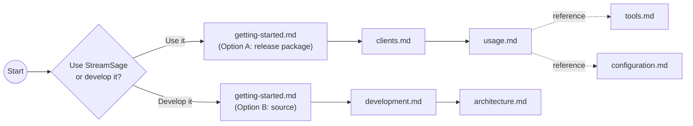

# StreamSage documentation

Pick the path that matches what you want to do:

## Using StreamSage

| Document | What you will find |
| --- | --- |
| [Getting started](getting-started.md) | Release package vs source setup, the sample environment, first questions |
| [Connecting clients](clients.md) | Claude Code, Claude Desktop, MCP Inspector, HTTP mode with tokens, real clusters |
| [Usage and example questions](usage.md) | Questions by scenario, investigation walkthroughs, tips |
| [Tool reference](tools.md) | Every tool, resource and prompt, with parameters and real responses |
| [Configuration](configuration.md) | Every environment variable, validation rules, ready-made profiles |
| [Security](security.md) | Least-privilege ACLs, authentication, data protection and its limits |

## Developing StreamSage

| Document | What you will find |
| --- | --- |
| [Development](development.md) | Setup, running your working tree, tests, CI, local brokers, releasing |
| [Architecture](architecture.md) | Layers, ports and adapters, request flows, design decisions |
| [Project specification](../PROJECT_SPEC.md) | The original specification the project was built from |
| [Changelog](../CHANGELOG.md) | Release history |
