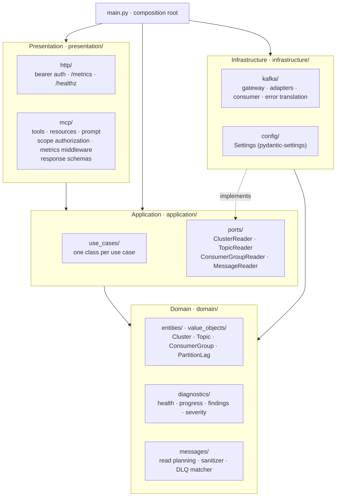
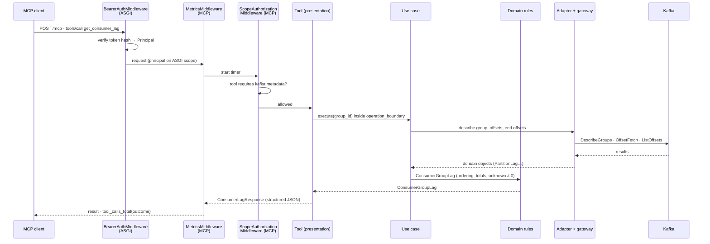
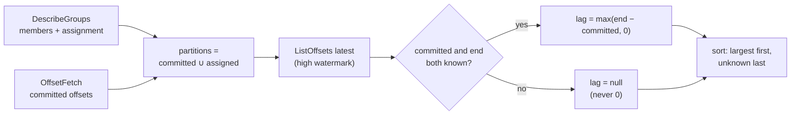
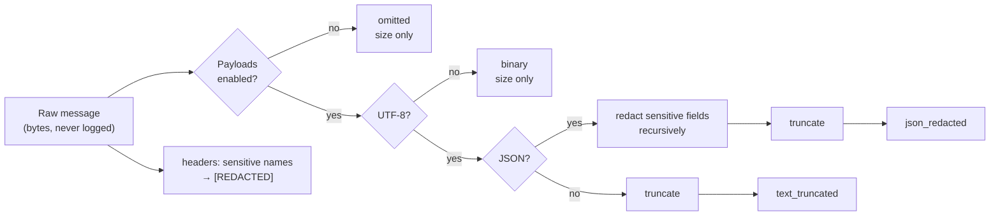

# Architecture

StreamSage follows **Clean Architecture** combined with **Ports and
Adapters** (hexagonal architecture). The domain holds the rules (lag, health,
progress, sanitization) as pure Python, with no Kafka and no MCP. Everything
external plugs in through ports.

## Layers



```text
src/streamsage/
├── domain/              Pure Python: entities, value objects, diagnostics, message rules
├── application/         Use cases and ports (typing.Protocol)
├── infrastructure/      Settings and Kafka adapters (confluent-kafka)
├── presentation/
│   ├── mcp/             MCP server: tools, resources, prompt, schemas, middlewares
│   └── http/            Streamable HTTP app: bearer auth, /metrics, /healthz
├── shared/              Cross-cutting: JSON logging, Prometheus metrics
└── main.py              Composition root and CLI (serve, generate-token)
```

## Dependency rule

| Layer | May import | Must not import |
| --- | --- | --- |
| `domain` | the standard library | anything else in the project, `confluent_kafka`, `mcp`, `pydantic` |
| `application` | `domain` | `infrastructure`, `presentation`, `confluent_kafka`, `mcp` |
| `infrastructure` | `domain`, `application` (ports), `shared` | `presentation`, `mcp` |
| `presentation` | `application`, `domain`, `shared`; `infrastructure.config` (settings) in `presentation/http` only | `confluent_kafka`, Kafka adapters |
| `main.py` | everything | – (the only place that creates concrete objects) |

Contract tests check that every Kafka adapter matches its port's signatures,
and that no adapter exposes a write-style method.

## Ports and adapters

| Port (application) | Adapter (infrastructure) | Kafka APIs used |
| --- | --- | --- |
| `ClusterReader` | `KafkaClusterAdapter` | Metadata (all topics) |
| `TopicReader` | `KafkaTopicAdapter` | Metadata (all topics), DescribeTopics |
| `ConsumerGroupReader` | `KafkaConsumerGroupAdapter` | ListGroups, DescribeGroups, OffsetFetch, ListOffsets |
| `MessageReader` | `KafkaMessageAdapter` | DescribeTopics, watermarks, assign-only consumer fetch |

Every admin request goes through `KafkaAdminGateway`, which applies timeouts,
drains librdkafka events, translates errors and records metrics.

## Request flow

How a tool call travels through the layers (HTTP transport shown; over
stdio the first two steps do not exist):



`operation_boundary` logs each operation with its correlation id and
duration, and converts anticipated errors into safe MCP errors. Any other
exception reaches the client only as a generic message.

## Key flows

### Lag computation



### Sanitization pipeline



## Decisions

- [MCP SDK 2.x (`MCPServer`)](#mcp-sdk-2x-mcpserver)
- [Topic metadata without accidental creation](#topic-metadata-without-accidental-creation)
- [One gateway for every Kafka request](#one-gateway-for-every-kafka-request)
- [Internal topics](#internal-topics)
- [Consumer lag](#consumer-lag)
- [Consumer health](#consumer-health)
- [Findings](#findings)
- [Configurable severity](#configurable-severity)
- [Stalled partitions (`detect_stalled_partitions`)](#stalled-partitions-detect_stalled_partitions)
- [Message inspection](#message-inspection)
- [Key search](#key-search)
- [DLQ topics](#dlq-topics)
- [HTTP transport and authorization](#http-transport-and-authorization)
- [Metrics](#metrics)
- [Controller id in KRaft](#controller-id-in-kraft)
- [Missing data is `None`](#missing-data-is-none)
- [Response schemas live in presentation](#response-schemas-live-in-presentation)
- [Error handling](#error-handling)
- [Lifecycle](#lifecycle)
- [Logging](#logging)

### MCP SDK 2.x (`MCPServer`)

In `mcp` 2.x, the v1 `FastMCP` class is renamed
to `mcp.server.mcpserver.MCPServer`. We use its decorators (`tool`,
`resource`, `prompt`) and run it with `run("stdio")`. Tool handlers are plain
synchronous functions; the SDK runs them in a worker thread. As the spec
requires, this keeps the synchronous Kafka client out of asyncio code.

### Topic metadata without accidental creation

Listings use
`AdminClient.list_topics(timeout=…)` with no topic argument. That single
response contains the cluster id, the controller id, the brokers and every
topic's partitions, leaders, replicas and ISR. Against Kafka 4.3, a Metadata
request scoped to a missing topic name (`list_topics(topic=…)`) *did*
auto-create that topic on a broker with `auto.create.topics.enable=true`, so
StreamSage never issues one.

`describe_topic` uses the DescribeTopics admin API
(`AdminClient.describe_topics`), which requests only the named topic. Its
cost therefore no longer grows with the size of the cluster. It reports
`UNKNOWN_TOPIC_OR_PART` for a missing topic and does not create it. This
was first verified against Kafka 4.3 with confluent-kafka 2.16, and
`test_missing_topic_raises_and_is_never_created` checks it on every CI run
against the broker version pinned in `docker-compose.yml`. The
local Docker broker keeps auto-creation enabled on purpose.

### One gateway for every Kafka request

Adapters never call the
`AdminClient` directly; they go through `KafkaAdminGateway`. It applies the
timeout and waits for future-based APIs with a bounded wait. It drains
librdkafka's event queue after each request, and translates errors, mapping
"does not exist" codes to `KafkaResourceNotFoundError`.

### Internal topics

Cluster metadata, which listings use, does not carry an
"internal" flag. There, topics whose names start with `__` (Kafka's reserved
prefix, for example `__consumer_offsets`) are treated as internal.
`describe_topic` uses the `is_internal` flag returned by DescribeTopics.

### Consumer lag

`get_consumer_lag` combines three reads:
DescribeConsumerGroups (state, members, assignment),
ListConsumerGroupOffsets (committed offsets) and ListOffsets with
`OffsetSpec.latest()` (log end offsets). It covers every partition the group
has committed *or* is currently assigned. That way a partition that is
assigned but has never been committed shows up with `lag: null`, instead of
being silently omitted. Rules:

- Unknown committed or end offsets give `lag: null`, never 0. `total_lag`
  sums only known lags, and `unknown_lag_partition_count` reports the rest.
- Lag is **offset lag**, an upper bound on unconsumed messages. Compaction
  leaves gaps in offsets and transaction markers use offsets, so fewer
  messages may be pending; StreamSage does not count them, which would mean
  reading them. Descriptions, findings and thresholds speak of offsets.
- The end offset is the high watermark (read_uncommitted). For consumers
  using `isolation.level=read_committed`, lag may be overstated while
  transactions are open.
- Offsets are read at slightly different moments, so a committed offset
  ahead of the read end offset yields 0 rather than a negative lag.
- A per-partition failure (for example a deleted partition) yields
  `log_end_offset: null` for that partition only. A connection,
  authentication or timeout failure fails the whole call, because partial
  results would mislead.
- Kafka answers DescribeGroups for an unknown id with an empty group in
  state `DEAD`, not an error. StreamSage reports that as "does not exist".
- If some brokers fail to answer a group listing, the groups that were
  returned are still listed and a warning is logged. If all brokers fail,
  the call fails.

### Consumer health

`analyze_consumer_health` is a pure domain function
(`domain/diagnostics/consumer_health.py`) applied to the group description
and its lag. Each rule produces a `Finding`: a stable `code`, a `severity`,
a summary, and the `evidence` behind it. Possible explanations are worded as
unverified hypotheses.

| Code | Severity | When |
| --- | --- | --- |
| `LAG_ABOVE_CRITICAL` | critical | Some partition lag ≥ critical threshold |
| `LAG_ABOVE_WARNING` | warning | Some partition lag ≥ warning threshold (and none critical) |
| `NO_ACTIVE_MEMBERS` | warning | No members while there is offset lag |
| `REBALANCING` | warning | Group is preparing or completing a rebalance |
| `UNASSIGNED_PARTITIONS_WITH_LAG` | warning | Members exist, but partitions with lag are assigned to none |
| `INACTIVE_CAUGHT_UP` | info | No members and no offset lag |
| `LAG_UNKNOWN` | info | Some partitions have unknown lag |
| `NO_PARTITIONS` | info | No committed offsets and no assignments |
| `STATE_UNKNOWN` | info | Coordinator reported no known state |

The overall status is the worst severity found. With no warning or critical
finding, it is `unknown` if no lag could be determined at all, and
`healthy` otherwise. Every report carries its limitations: it is one
snapshot, and the thresholds (`STREAMSAGE_LAG_*_THRESHOLD`, per partition, in
messages) are configured values, not derived from the consumer's throughput.
The analysis never states that a consumer is stuck or names a root cause.

### Findings

Every diagnostic produces `Finding`s
(`domain/diagnostics/finding.py`) with:

- `code`: stable identifier (the full list is in `diagnostics/catalog.py`);
- `severity`: `info`, `warning` or `critical`;
- `summary`: only what was observed;
- `evidence`: the observed values behind the summary (capped per finding);
- `hypotheses`: possible explanations, unverified by definition;
- `recommendations`: read-only next steps.

Summaries never contain hypotheses, and no finding asserts a root cause.
Insufficient data is reported explicitly, through findings whose summary
starts with "Insufficient data" and a `unknown` status, never as `healthy`.

### Configurable severity

`STREAMSAGE_FINDING_SEVERITY_OVERRIDES` (JSON)
maps finding codes to severities, for example to treat inactive groups as
`info` or not-advancing partitions as `critical`. The overall status is
computed after overrides. Unknown codes and invalid values are rejected at
startup, so a typo cannot silently disable an override.

### Stalled partitions (`detect_stalled_partitions`)

The spec's rule is that
absence of progress can only be detected by comparing offsets at more than
one point in time. The MVP has no persistence and no background monitoring,
so the tool takes both samples **within a single call**: it reads the
group's committed and end offsets, waits `interval_seconds` (1–60, default
10), reads them again, and compares partition by partition:

| Status | Rule |
| --- | --- |
| `advancing` | committed offset increased |
| `caught_up` | committed offset unchanged, offset lag 0 |
| `not_advancing` | committed offset unchanged, offset lag above 0 |
| `moved_backward` | committed offset decreased (reset or reprocessing) |
| `unknown` | an offset is missing from either sample |

`not_advancing` partitions produce a `PARTITIONS_NOT_ADVANCING` warning. Its
evidence includes how many of them received new messages during the window.
Committed offsets are not the consumer's in-memory position: a consumer that
commits less often than the interval can look stalled. The finding says so,
and recommends sampling again with a longer interval. The call blocks for at
least `interval_seconds`, which must stay below the MCP client's request
timeout.

Alternatives considered: an in-memory snapshot store, compared across calls,
would add state and lifecycle questions. Background sampling is out of
scope for the MVP. Both remain possible later without changing the domain
function, which only compares two samples.

### Message inspection

`inspect_messages` follows the same layering as the
rest of the server:

- `MessageReader` port: `partition_offsets()` (the topic is checked with
  DescribeTopics first, so a missing topic is never auto-created) and
  `read_range()`.
- Pure domain planning (`domain/messages/planning.py`) decides which
  offsets to read: the newest N per partition, or N from an offset.
  Retention gaps and empty partitions become explicit notes.
- Pure domain sanitization (`domain/messages/sanitizer.py`) turns raw
  messages into `InspectedMessage`s before they leave the application layer.
- `KafkaMessageAdapter` reads partition offsets with two batched ListOffsets
  requests (earliest and latest) through the gateway, not one watermark
  request per partition. Partitions whose offsets cannot be read are
  reported as unavailable, not silently skipped.
- For reads, it creates a short-lived consumer per call, assigns the planned
  ranges, reads up to their end (or the partition end, or the timeout), and
  closes the consumer. A timeout yields a partial result marked
  `complete: false`.
- **Bounded resources.** `limit` bounds the output, and
  `STREAMSAGE_MESSAGE_INSPECT_MAX_READ` bounds how many messages are read.
  While reading, `NewestMessages` (a heap in `domain/messages/selection.py`)
  keeps only the `limit` newest, so memory does not grow with the number of
  partitions. An exact "newest N" needs N messages from every partition.
  When the budget does not allow that, the plan reads fewer per partition
  and the result is marked `exact: false`. Payloads above
  `STREAMSAGE_MESSAGE_MAX_DECODE_BYTES` are dropped as they are read (only
  their size is kept) and are never decoded or parsed.
  `max.partition.fetch.bytes` does not cap a single message: Kafka always
  returns at least one whole message, so an oversized message still
  crosses the network once.

### Key search

Kafka has no index by key, so `find_messages_by_key` scans
the newest messages of each partition. The total budget is split evenly
across the selected partitions and capped per partition
(`plan_key_scan`). The response reports each partition's scanned range and
whether it reached the oldest available message; `searched_whole_topic`
is true only if every partition was covered entirely and the scan
completed. A "no match" with partial coverage is reported as exactly that,
not as "the key does not exist". The adapter keeps only the newest N
matches per partition while scanning.

### DLQ topics

There is no universal DLQ naming convention. A topic is a DLQ
only if it matches `STREAMSAGE_DLQ_TOPICS` (exact names or glob patterns,
case-sensitive). Without that setting, `list_dlq_topics` says so explicitly
instead of guessing. Message counts are upper bounds from offsets: compaction
and transaction markers can leave gaps. To read DLQ messages, including
error headers, use `inspect_messages`.

See [security.md](security.md#data-protection) for the privacy rules and
their limits.

### HTTP transport and authorization

Static bearer tokens did not fit
the SDK's built-in auth, which is an OAuth resource server that requires an
authorization server (`issuer_url`) and would advertise OAuth metadata
StreamSage cannot honor. Instead, two layers wrap the SDK's Streamable HTTP
app:

1. `BearerAuthMiddleware` (ASGI, `presentation/http`) authenticates the
   token and stores a `Principal` (token name and scopes) in the request's
   ASGI scope.
2. `ScopeAuthorizationMiddleware` (MCP server middleware,
   `presentation/mcp/authorization.py`) reads that principal from the
   request the SDK attaches to each message (`ctx.request`). It enforces
   `TOOL_SCOPES` on `tools/call`, enforces the metadata scope on resources,
   and filters `tools/list`.

The principal travels with the request, not in a context variable, because
the SDK may process messages in a different task than the HTTP request.
Over stdio, `ctx.request` is `None` and nothing is restricted. With protocol
`2026-07-28`, the middleware receives already-serialized results (dicts), so
filtering handles both shapes; an end-to-end test over real HTTP guards
this.

### Metrics

`ServerMetrics` (`shared/metrics.py`) owns a dedicated
Prometheus registry, created by the composition root rather than held as
process-global state. Four places record into it:

- an MCP middleware for tool calls; it is the outermost middleware, so calls
  denied by authorization are counted too;
- `KafkaAdminGateway` and `KafkaMessageAdapter` for Kafka requests;
- the bearer middleware for authentication failures;
- the authorization middleware for scope denials.

Labels only take values defined in code. `/metrics` is served in HTTP mode
only; over stdio there is no listener to scrape.

### Controller id in KRaft

In KRaft mode, the Metadata response's
`controller_id` is a live broker id, not the active quorum controller. The
field is documented as such in the tool's output schema.

### Missing data is `None`

When the cluster does not report a value, such as
a cluster id, a controller or a partition leader, StreamSage returns `null`.
It never substitutes a placeholder.

### Response schemas live in presentation

Use cases return domain entities.
The MCP layer maps them to Pydantic response models (`presentation/mcp/schemas.py`),
which define the public wire contract. A separate `application/dto` layer
would have duplicated these models without adding value in M1, so it was not
created.

### Error handling

Infrastructure translates `KafkaException` into the
StreamSage hierarchy (`KafkaConnectionError`, `KafkaOperationTimeoutError`,
`KafkaResourceNotFoundError`, `KafkaMetadataError`, ...), and messages include
only Kafka error *codes*. `operation_boundary` turns those errors into MCP
`ToolError`/`ResourceError` with the same safe message. Any other exception
propagates to the SDK, which returns only `Error executing tool <name>`, so
internals never reach the client.

### Lifecycle

`build_application` is a context manager. The `AdminClient` is
created once and closed when the server stops, and there are no global
singletons.

### Logging

JSON lines go to stderr, because stdout is reserved for the stdio
transport. librdkafka logs are routed through Python logging; they are
delivered when the client is polled, which happens after every metadata
request. Each MCP operation logs `operation`, `correlation_id`, `outcome`,
`error_type` and `duration_ms`.

`correlation_id` is the JSON-RPC id of the MCP request, received through the
SDK's request `Context`. That parameter is not part of the tool's input
schema. The id is unique only within one client connection, which is enough
to match a log line to the call that produced it. The SDK does not inject a
request context into static resources, so `kafka://` resource reads log
`correlation_id: null`.
