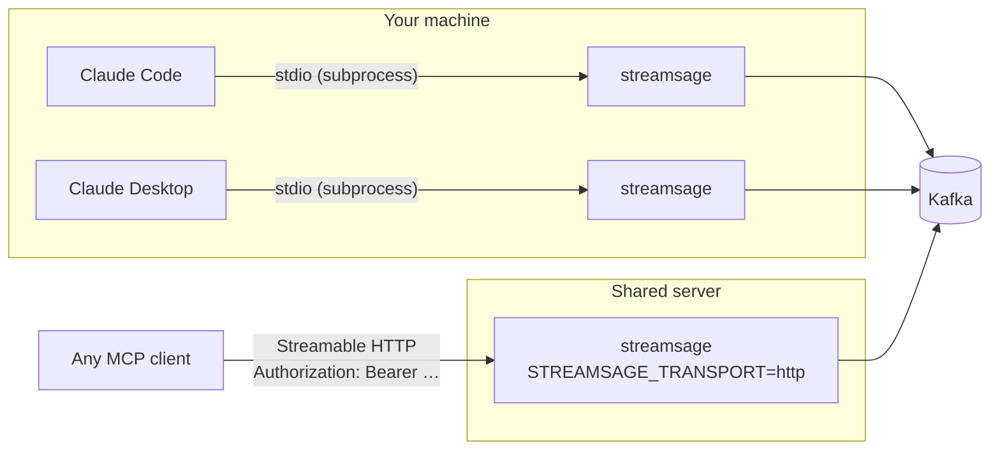
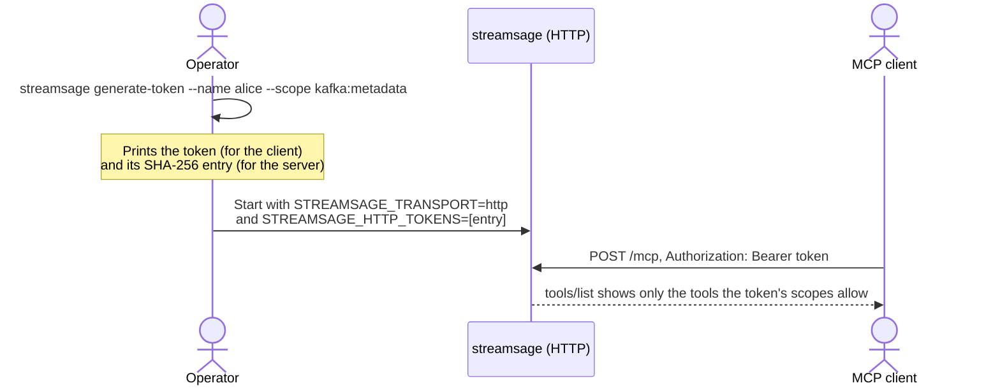

# Connecting MCP clients

StreamSage is a standard MCP server, so any MCP client can use it. This page
covers the most common clients, both transports, and connecting to a real
(secured) cluster.



| Transport | When to use it | Authentication |
| --- | --- | --- |
| **stdio** (default) | One user, on the machine that runs the client | None needed: the client starts StreamSage as a local subprocess |
| **Streamable HTTP** | A shared server, several users, or a client on another machine | Bearer tokens with scopes |

## Which command does the client run?

Every stdio configuration below comes in two variants, matching the two
[setups](getting-started.md#choose-your-setup):

| Setup | Command | Use when |
| --- | --- | --- |
| **Release package** | `streamsage` (after `uv tool install …`) | You use StreamSage; the version is fixed until you upgrade |
| **Source checkout** | `uv run --directory /path/to/streamsage streamsage` | You develop StreamSage; the client runs your working tree |
| **No install** | `uvx --from <wheel URL> streamsage` | Quick trials; uv caches the package |

## Claude Code

### stdio (recommended for local use)

**Release package:**

```bash
claude mcp add streamsage -s user \
  -e STREAMSAGE_KAFKA_BOOTSTRAP_SERVERS=localhost:9092 \
  -e STREAMSAGE_DLQ_TOPICS='*.DLQ' \
  -- streamsage
```

**Source checkout** (from the repository root):

```bash
claude mcp add streamsage-dev -s local \
  -e STREAMSAGE_DLQ_TOPICS='*.DLQ' \
  -e STREAMSAGE_MESSAGE_PAYLOADS_ENABLED=true \
  -- uv run --directory "$PWD" streamsage
```

| Part | Meaning |
| --- | --- |
| `-s user` / `-s local` | `user`: every project on your machine (fits an installed tool). `local`: only you, only this project (fits a checkout). `-s project` shares the config through a committed `.mcp.json`; never put secrets there. |
| `-e KEY=value` | Environment for the server. Any variable from [configuration.md](configuration.md) works here. |
| `-- streamsage` / `-- uv run --directory … streamsage` | The command Claude Code starts as a subprocess |

Using different names (`streamsage` and `streamsage-dev`) lets you keep
both side by side, for example to compare a release with your changes.

Then:

```bash
claude mcp list                # the server should show ✔ Connected
claude mcp get streamsage      # shows the command and environment
```

Start a new session, or run `/mcp` inside Claude Code to reconnect. The
server exposes 11 tools, 2 resources and 1 prompt.

> **Updating:** a running session keeps the server process it started.
> After upgrading the package, pulling new code or changing environment
> variables, start a new session or reconnect with `/mcp`.

To change the environment, remove and re-add the server:

```bash
claude mcp remove streamsage -s user
claude mcp add streamsage -s user -e … -- streamsage
```

### Streamable HTTP

Point Claude Code at a running HTTP server (see
[HTTP mode](#http-mode-shared-server) for starting one):

```bash
claude mcp add --transport http streamsage http://127.0.0.1:8000/mcp \
  --header "Authorization: Bearer <token>"
```

## Claude Desktop

Edit the configuration file:

| OS | Path |
| --- | --- |
| macOS | `~/Library/Application Support/Claude/claude_desktop_config.json` |
| Windows | `%APPDATA%\Claude\claude_desktop_config.json` |

**Release package** (find the path with `which streamsage`, usually
`~/.local/bin/streamsage`):

```json
{
  "mcpServers": {
    "streamsage": {
      "command": "/Users/you/.local/bin/streamsage",
      "env": {
        "STREAMSAGE_KAFKA_BOOTSTRAP_SERVERS": "localhost:9092",
        "STREAMSAGE_DLQ_TOPICS": "*.DLQ"
      }
    }
  }
}
```

**Source checkout:**

```json
{
  "mcpServers": {
    "streamsage-dev": {
      "command": "/absolute/path/to/uv",
      "args": ["run", "--directory", "/absolute/path/to/streamsage", "streamsage"],
      "env": {
        "STREAMSAGE_KAFKA_BOOTSTRAP_SERVERS": "localhost:9092",
        "STREAMSAGE_DLQ_TOPICS": "*.DLQ",
        "STREAMSAGE_MESSAGE_PAYLOADS_ENABLED": "true"
      }
    }
  }
}
```

Use absolute paths: desktop apps often do not inherit your shell's `PATH`.
Restart Claude Desktop after editing. Copies of these files are in
[examples/](../examples/).

## MCP Inspector

The [MCP Inspector](https://github.com/modelcontextprotocol/inspector) lets
you call tools by hand, which is useful for exploring responses or debugging.

Replace `streamsage` with `uv run --directory "$PWD" streamsage` in the
commands below when working from a source checkout.

**Web UI:**

```bash
npx @modelcontextprotocol/inspector \
  -e STREAMSAGE_DLQ_TOPICS='*.DLQ' -e STREAMSAGE_MESSAGE_PAYLOADS_ENABLED=true \
  streamsage
```

**CLI** (scriptable; output is JSON):

```bash
# List tools
npx @modelcontextprotocol/inspector --cli streamsage --method tools/list

# Call a tool
npx @modelcontextprotocol/inspector --cli streamsage \
  --method tools/call --tool-name get_consumer_lag --tool-arg group_id=orders-service

# Pass environment variables with -e (the Inspector does not forward your shell's)
npx @modelcontextprotocol/inspector --cli -e STREAMSAGE_DLQ_TOPICS='*.DLQ' \
  streamsage --method tools/call --tool-name list_dlq_topics

# Against an HTTP server
npx @modelcontextprotocol/inspector --cli http://127.0.0.1:8000/mcp \
  --header "Authorization: Bearer <token>" --method tools/list
```

## HTTP mode (shared server)



### 1. Create a token per client

```bash
streamsage generate-token --name alice --scope kafka:metadata --scope kafka:messages
```

```text
Token (give it to the MCP client; it is not stored anywhere):
  ssk_…

Add this entry to the STREAMSAGE_HTTP_TOKENS JSON list:
  {"name": "alice", "sha256": "…", "scopes": ["kafka:messages", "kafka:metadata"]}
```

| Scope | Tools |
| --- | --- |
| `kafka:metadata` | `get_cluster_info`, `list_topics`, `describe_topic`, `list_consumer_groups`, `describe_consumer_group`, `get_consumer_lag`, `analyze_consumer_health`, `detect_stalled_partitions`, `list_dlq_topics`, and the `kafka://` resources |
| `kafka:messages` | `inspect_messages`, `find_messages_by_key` |

Give message access only to clients that need it. A token without
`kafka:messages` does not even see those tools.

### 2. Start the server

```bash
STREAMSAGE_TRANSPORT=http \
STREAMSAGE_HTTP_TOKENS='[{"name": "alice", "sha256": "…", "scopes": ["kafka:messages", "kafka:metadata"]}]' \
streamsage
```

| Endpoint | Auth | Purpose |
| --- | --- | --- |
| `POST /mcp` | Bearer token | MCP (Streamable HTTP) |
| `GET /healthz` | Public | Liveness check; does not contact Kafka |
| `GET /metrics` | Bearer token (unless `STREAMSAGE_HTTP_METRICS_PUBLIC=true`) | Prometheus metrics |

The server listens on `127.0.0.1:8000` by default. To serve other machines,
set `STREAMSAGE_HTTP_HOST=0.0.0.0` **and** put a TLS-terminating reverse
proxy in front: StreamSage itself serves plain HTTP.

### 3. Connect clients

Use the Claude Code or Inspector commands above with the token. Any client
that supports Streamable HTTP with custom headers works the same way.

### Rotating or revoking a token

Add the new entry, update the client, then remove the old entry and restart
the server. Tokens are identified by `name` in logs and metrics, never by
value.

## Connecting to a real cluster

Pass the Kafka settings as environment variables, in the client config or
the server's environment. For example, SASL/SCRAM over TLS with Claude Code:

```bash
claude mcp add streamsage-prod -s local \
  -e STREAMSAGE_KAFKA_BOOTSTRAP_SERVERS=broker-1.example.com:9096,broker-2.example.com:9096 \
  -e STREAMSAGE_KAFKA_SECURITY_PROTOCOL=SASL_SSL \
  -e STREAMSAGE_KAFKA_SASL_MECHANISM=SCRAM-SHA-512 \
  -e STREAMSAGE_KAFKA_SASL_USERNAME=streamsage-readonly \
  -e STREAMSAGE_KAFKA_SASL_PASSWORD="$STREAMSAGE_PROD_PASSWORD" \
  -- streamsage
```

Use a **dedicated, read-only Kafka principal**: see
[security.md](security.md#least-privilege) for the minimal ACLs. More
profiles (TLS with a private CA, HTTP, tuning) are in
[configuration.md](configuration.md#ready-made-profiles).

## Other MCP clients

Most clients accept the same shape as Claude Desktop: a `command`, `args`
and `env` for stdio, or a URL plus headers for Streamable HTTP. Check your
client's documentation for the exact file location and keys.

## Troubleshooting

| Symptom | Cause | Fix |
| --- | --- | --- |
| Server shows as failed or disconnected | Wrong path, or `uv`/`streamsage` not found by a desktop app | Use absolute paths (`which streamsage`, `which uv`); run the same command in a terminal to see the error |
| `streamsage: invalid configuration: …` | A setting is invalid or inconsistent | Read the message; it names the variable, never its value |
| Only some tools are listed | Old server process, or (HTTP) the token lacks a scope | Reconnect with `/mcp`; check the token's scopes |
| `401` from the HTTP server | Missing or wrong token | Send `Authorization: Bearer <token>`; check the hash in `STREAMSAGE_HTTP_TOKENS` |
| "Authentication with the Kafka cluster failed" | Wrong SASL mechanism, username or password | Verify the `STREAMSAGE_KAFKA_SASL_*` values |
| "TLS handshake with the Kafka cluster failed" | Broker certificate not trusted, or host mismatch | Set `STREAMSAGE_KAFKA_SSL_CA_LOCATION` to the broker's CA bundle |
| Logs on stderr | Expected | StreamSage logs JSON to stderr; stdout carries the MCP protocol |
