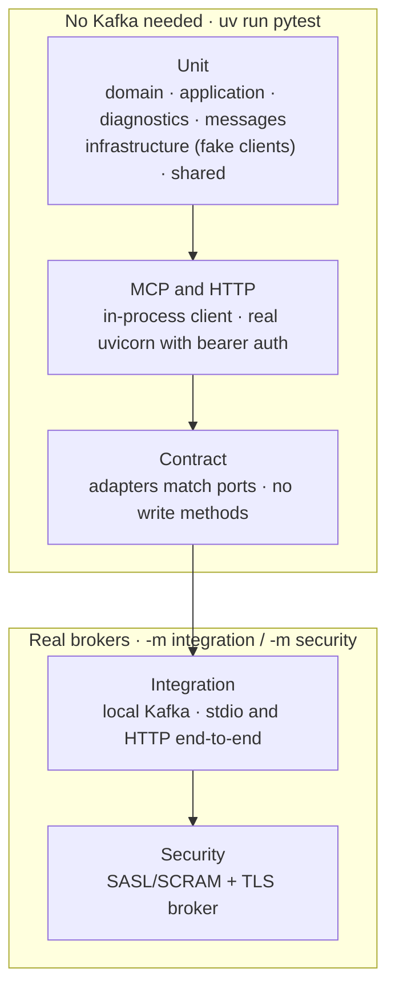
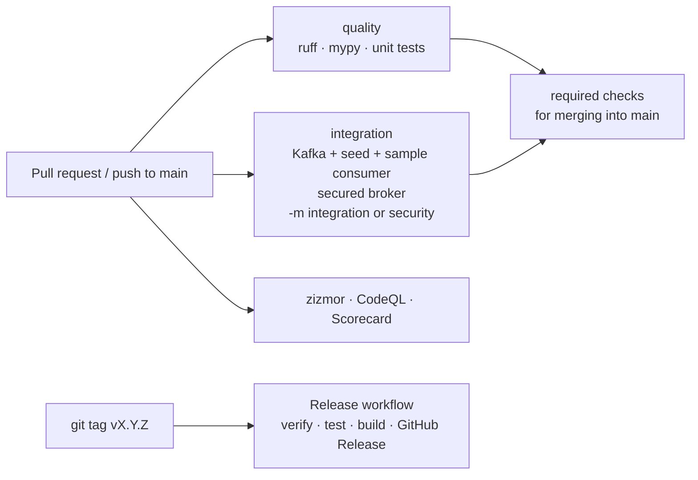
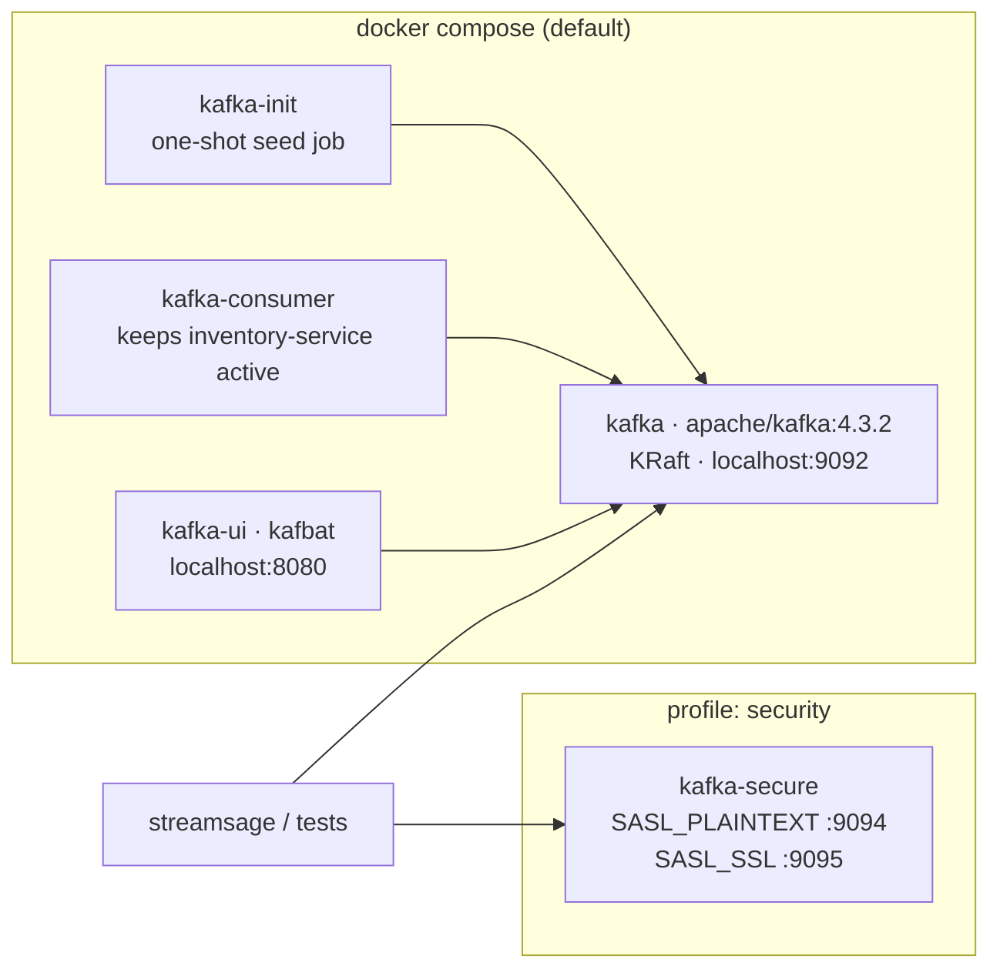

# Development

This guide is for working **on** StreamSage from a source checkout. To
**use** StreamSage, install the release package instead; see
[getting-started.md](getting-started.md#option-a-use-the-release-package).

| | Source checkout (this guide) | Release package |
| --- | --- | --- |
| Get it | `git clone` + `uv sync` | `uv tool install <wheel URL>` |
| Run it | `uv run streamsage` | `streamsage` |
| MCP client command | `uv run --directory <checkout> streamsage` | `streamsage` |
| Includes | Source, tests, docs, local Kafka environments | The installed package only |

## Setup

```bash
git clone https://github.com/FVitor7/streamsage.git && cd streamsage
uv sync                      # .venv with runtime + dev dependencies (from uv.lock)
uv run pre-commit install    # optional: ruff + mypy on commit
make kafka-up                # local Kafka with sample data
```

The minimum supported version is Python 3.12 (`requires-python = ">=3.12"`).
Development and CI run on that minimum, pinned in `.python-version`, so the
supported floor is always the version under test. ruff
(`target-version = "py312"`) and mypy (`python_version = "3.12"`) target the
same version.

## Running your working tree

Register your checkout with an MCP client under a separate name, so it can
live next to an installed release:

```bash
claude mcp add streamsage-dev -s local \
  -e STREAMSAGE_DLQ_TOPICS='*.DLQ' \
  -e STREAMSAGE_MESSAGE_PAYLOADS_ENABLED=true \
  -- uv run --directory "$PWD" streamsage
```

`uv run` always executes your current code. After a change, reconnect the
client (`/mcp` in Claude Code) so it starts a new server process. To call
tools by hand, use `make inspector` (MCP Inspector web UI) or the Inspector
CLI described in [clients.md](clients.md#mcp-inspector).

## Make targets

| Target | What it does |
| --- | --- |
| `make install` | `uv sync` |
| `make check` | Lint, format check, mypy (strict), unit tests with coverage |
| `make lint` / `make format` / `make typecheck` / `make test` | The individual steps |
| `make kafka-up` / `make kafka-down` / `make kafka-logs` | Local Kafka with sample data, plus the sample consumer and Kafka UI |
| `make test-integration` | Tests against the local broker |
| `make kafka-secure-up` / `make kafka-secure-down` | Secured broker (SASL/SCRAM + TLS) with generated credentials |
| `make test-security` | SASL/TLS tests |
| `make run` | `uv run streamsage` (stdio) |
| `make inspector` | MCP Inspector web UI against your working tree |

## Quality gate

```bash
uv run ruff check .
uv run ruff format --check .
uv run mypy src/        # strict mode
uv run pytest --cov     # unit, contract and MCP tests; branch coverage ≥ 80%
```

`make check` runs all of the above. CI also runs the integration and security
suites against real brokers.

## Tests



| Path | What it covers | Needs Kafka |
| --- | --- | --- |
| `tests/unit/domain`, `tests/unit/diagnostics`, `tests/unit/messages` | Entities, health and progress rules, read planning, sanitization | no |
| `tests/unit/application` | Use cases with in-memory fakes | no |
| `tests/unit/infrastructure` | Settings, client config, error translation, adapters with real confluent-kafka objects | no |
| `tests/unit/presentation`, `tests/unit/http` | MCP tools in-process; bearer auth, scopes and metrics over real HTTP (uvicorn) | no |
| `tests/unit/shared`, `tests/unit/test_*.py` | Logging, metrics, CLI, release consistency | no |
| `tests/contract` | Adapters satisfy ports; no write operations | no |
| `tests/integration` | Real broker, plus end-to-end stdio and HTTP servers | **yes** |
| `tests/security` | SASL/SCRAM and TLS against a secured broker, plus stdio over `SASL_SSL` | **yes** (secured) |

Async tests use the anyio pytest plugin (`@pytest.mark.anyio`). Tests never
contain credential-like literals: they generate them at runtime
(`tests.fakes.random_credential`), and integration tests read seeded random
values from Kafka.

## Continuous integration



## Integration tests

```bash
make kafka-up                # broker + seeded data + sample consumer
uv run pytest -m integration # or: make test-integration
```

The fixtures wait up to 90 s for the broker and the sample topics, and the
active-consumer tests wait for `inventory-service`'s first commit. Set
`STREAMSAGE_KAFKA_BOOTSTRAP_SERVERS` to point the tests at a different broker.
Integration tests expect the deterministic sample data: if an old volume
gives different numbers, reset it with `docker compose down -v && make kafka-up`.

## Security tests (SASL/SCRAM + TLS)

```bash
docker/kafka-secure/setup.sh       # or: make kafka-secure-up
uv run pytest -m security          # or: make test-security
```

`setup.sh` starts a second, dev-only broker (compose profile `security`):

| Port             | Protocol         | Authentication                        |
| ---------------- | ---------------- | ------------------------------------- |
| `localhost:9094` | `SASL_PLAINTEXT` | SCRAM-SHA-512                         |
| `localhost:9095` | `SASL_SSL`       | SCRAM-SHA-512 over TLS (test-only CA) |

On the first run, it generates everything into `docker/kafka-secure/.generated/`
(gitignored): a random SCRAM password for the user `streamsage`, a throwaway
CA (`ca.pem`), and the broker keystore. The certificates are created with the
`keytool` inside the Kafka image, so the host only needs Docker and
`openssl`. CI regenerates all of it on every run. To start from scratch,
delete the folder and run `docker compose --profile security down -v`.

The suite checks that:

- valid credentials work on both listeners, with TLS verified against the
  configured CA;
- a wrong password is reported as an authentication failure, and an
  untrusted certificate as a TLS failure, instead of a generic connection
  error;
- no password appears in errors or logs, including librdkafka's own logs;
- the real `streamsage` process works end to end over stdio with `SASL_SSL`.

## Local Kafka



- The broker is a single combined broker/controller in KRaft mode. Its host
  listener is `localhost:9092`; other containers use `kafka:19092`. Data
  lives in the `kafka-data` volume (`docker compose down -v` removes it).
- `auto.create.topics.enable=true` on purpose, so tests can prove that
  StreamSage never creates topics.
- `docker/kafka/init-topics.sh` seeds deterministic data once per volume.
  Topics are created in parallel, because each Kafka CLI call starts a JVM:
  a fresh seed takes about 20 s, a re-run a few seconds. The topics, groups
  and lag values are described in
  [getting-started.md](getting-started.md#what-the-sample-environment-contains).
- These dev-only containers write to Kafka; StreamSage itself never does.

## Building the package locally

```bash
uv build                                   # dist/streamsage-X.Y.Z.tar.gz and .whl
uv venv /tmp/ss-venv && VIRTUAL_ENV=/tmp/ss-venv uv pip install dist/*.whl
/tmp/ss-venv/bin/streamsage --help         # what release users get
```

## Releasing

Releases are GitHub Releases; nothing is published to package registries.

1. Update the version in `pyproject.toml`; `streamsage.__version__` reads it
   from the installed package metadata. Run `uv lock`.
2. Move the `[Unreleased]` entries in `CHANGELOG.md` under a new
   `## [X.Y.Z] - YYYY-MM-DD` heading, and update the comparison links.
3. Merge the change into `main` through a pull request.
4. Tag the merge commit and push the tag:

   ```bash
   git tag -a vX.Y.Z -m "StreamSage vX.Y.Z"
   git push origin vX.Y.Z
   ```

The `Release` workflow (`.github/workflows/release.yml`) then:

- checks that the tag matches the version in `pyproject.toml`;
- runs lint, type checks and unit tests;
- builds the sdist and wheel;
- creates the GitHub Release, with the matching `CHANGELOG.md` section as
  notes (`scripts/release_notes.py` fails if that section is missing) and
  the built files attached.

The workflow uses pinned action SHAs, minimal permissions and no cache, and
passes `zizmor`.
