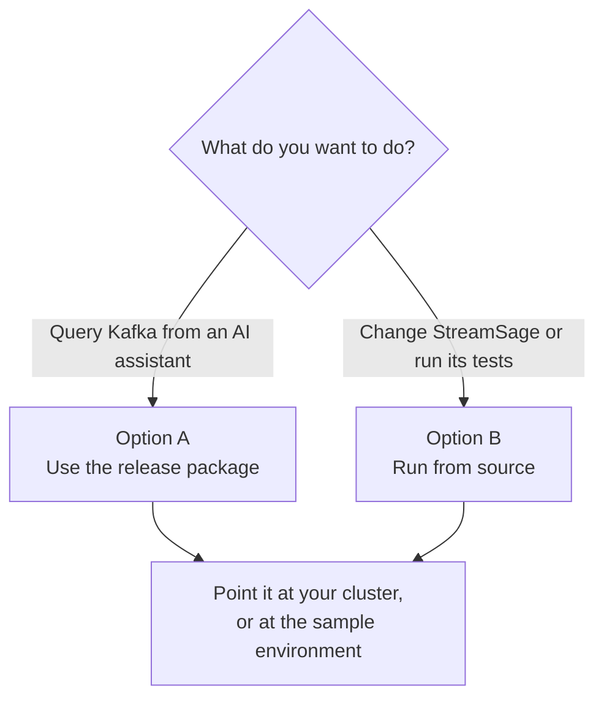
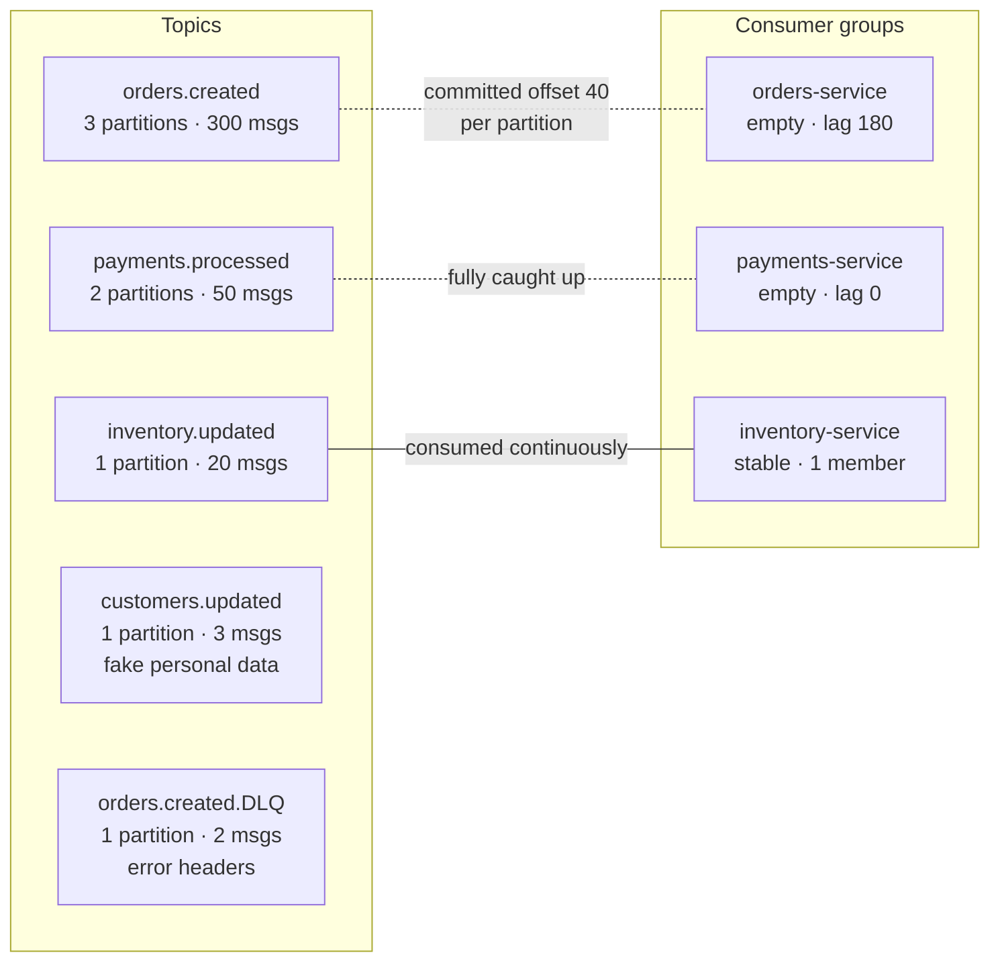

# Getting started

This guide takes you from a fresh clone to asking an AI assistant about a
real Kafka cluster in about five minutes. You will use the **sample
environment**: a local Kafka broker pre-populated with topics, consumer
groups, lag, a dead letter queue and (fake) personal data, so every tool has
something interesting to show.

## Choose your setup



| | Option A: release package | Option B: source checkout |
| --- | --- | --- |
| Install | `uv tool install <wheel URL>` | `git clone` + `uv sync` |
| Client runs | `streamsage` | `uv run --directory <checkout> streamsage` |
| Code | The released version | Your working tree (changes apply on reconnect) |
| Sample environment | Clone the tag for its `docker-compose.yml` | Included |
| Extra tooling | – | Tests, linters, local brokers ([development.md](development.md)) |

## 1. Prerequisites

| Tool | Option A | Option B | Used for |
| --- | --- | --- | --- |
| Python 3.12+ | ✅ | ✅ | Running StreamSage |
| [uv](https://docs.astral.sh/uv/) | ✅ (or pip) | ✅ | Installing and running |
| Docker with Compose v2 | only for the sample environment | ✅ | The local Kafka broker |
| An MCP client | ✅ | ✅ | [Claude Code](https://claude.com/claude-code), Claude Desktop or the MCP Inspector |

## 2. Install

### Option A: use the release package

```bash
uv tool install https://github.com/FVitor7/streamsage/releases/download/v1.1.1/streamsage-1.1.1-py3-none-any.whl
streamsage --help        # installed in ~/.local/bin
```

Other methods (uvx, pip, from a tag) are listed under
[Installation](../README.md#installation). Your MCP client will run the
`streamsage` command.

### Option B: run from source (development)

```bash
git clone https://github.com/FVitor7/streamsage.git
cd streamsage
uv sync                  # creates .venv with runtime and dev dependencies
uv run streamsage --help
```

Your MCP client will run `uv run --directory <checkout> streamsage`, so it
always uses your current working tree. For tests, linters and local brokers,
continue with [development.md](development.md).

## 3. Start Kafka with sample data

Skip this step if you are connecting to your own cluster; set
`STREAMSAGE_KAFKA_BOOTSTRAP_SERVERS` (and security settings, see
[configuration.md](configuration.md)) instead.

The sample environment lives in the repository. With Option B you already
have it. With Option A, fetch the files for your version (only Docker is
needed to run them):

```bash
git clone --depth 1 --branch v1.1.1 https://github.com/FVitor7/streamsage.git streamsage-sample
cd streamsage-sample
```

Then, from the repository directory:

```bash
make kafka-up
```

This starts a single Kafka 4 broker in KRaft mode (the exact version is pinned in
`docker-compose.yml`) and seeds it. It takes
about 30 seconds on first run; later runs reuse the data. It also starts:

| Container | Purpose | Address |
| --- | --- | --- |
| `streamsage-kafka` | Kafka broker | `localhost:9092` |
| `streamsage-kafka-init` | One-shot job that seeds the sample data | – |
| `streamsage-kafka-consumer` | A consumer that keeps `inventory-service` active | – |
| `streamsage-kafka-ui` | [kafbat/kafka-ui](https://github.com/kafbat/kafka-ui), for comparing answers | http://localhost:8080 |

### What the sample environment contains



| Topic | Partitions | Messages | Notes |
| --- | --- | --- | --- |
| `orders.created` | 3 | 300 | Keys `key-1` … `key-300`, JSON values `{"seq": N}` |
| `payments.processed` | 2 | 50 | Keyed messages |
| `inventory.updated` | 1 | 20 | Read continuously by the sample consumer |
| `customers.updated` | 1 | 3 | Fake emails, passwords, phones, card numbers and an `Authorization` header, for testing sanitization |
| `orders.created.DLQ` | 1 | 2 | Failed orders with `error.class`, `error.message` and `original.offset` headers |

| Consumer group | State | Lag | What it demonstrates |
| --- | --- | --- | --- |
| `orders-service` | `empty` | **180** (66 / 60 / 54) | A group with no members falling behind |
| `payments-service` | `empty` | 0 | An inactive group that is caught up |
| `inventory-service` | `stable` | 0 | An active group with one member |

Committed offsets are set with `kafka-consumer-groups.sh --reset-offsets`, so
the lag values are deterministic. The credential-like values in
`customers.updated` are generated randomly each time the data is seeded.

## 4. Connect an MCP client

With Claude Code, register the server once. Both variants pass the two
settings that make the sample data most useful:

- `STREAMSAGE_DLQ_TOPICS='*.DLQ'` tells StreamSage that `orders.created.DLQ`
  is a dead letter queue. StreamSage assumes no naming convention.
- `STREAMSAGE_MESSAGE_PAYLOADS_ENABLED=true` includes sanitized payload
  previews. Without it you see keys, headers and sizes only.

**Option A: release package**

```bash
claude mcp add streamsage -s user \
  -e STREAMSAGE_DLQ_TOPICS='*.DLQ' \
  -e STREAMSAGE_MESSAGE_PAYLOADS_ENABLED=true \
  -- streamsage
```

**Option B: source checkout** (from the repository root)

```bash
claude mcp add streamsage-dev -s local \
  -e STREAMSAGE_DLQ_TOPICS='*.DLQ' \
  -e STREAMSAGE_MESSAGE_PAYLOADS_ENABLED=true \
  -- uv run --directory "$PWD" streamsage
```

Open a **new** Claude Code session (or run `/mcp` to reconnect) and check
that the server is connected with 11 tools. For Claude Desktop, the MCP
Inspector or HTTP mode, see [clients.md](clients.md).

## 5. Ask your first questions

| Try asking | You should see |
| --- | --- |
| "What topics are in this Kafka cluster?" | The 5 sample topics and their partition counts |
| "Which consumer groups have the highest lag?" | `orders-service`, 180 offsets behind |
| "Is orders-service healthy? Is it stuck?" | `warning`, no active members, partitions not advancing |
| "Are there messages in a DLQ? Why did they fail?" | 2 messages, with `error.message` such as `order total is negative` |
| "Show me the latest messages in customers.updated." | Payloads with `email`, `password` and `phone` as `[REDACTED]` |

Compare the answers with the Kafka UI at http://localhost:8080. More
questions and complete walkthroughs are in [usage.md](usage.md).

## 6. Stop or reset

```bash
docker compose down      # stop; data is kept
docker compose down -v   # stop and delete data; the next `make kafka-up` reseeds
```

## Troubleshooting

| Symptom | Likely cause | Fix |
| --- | --- | --- |
| "Could not connect to the Kafka cluster" | Kafka is not running | `make kafka-up`, then `docker compose ps` |
| The client shows only a few tools | The MCP server process predates an update | Restart the client session or run `/mcp` to reconnect |
| `streamsage: command not found` (Option A) | `~/.local/bin` is not on `PATH` | Run `uv tool update-shell`, or use the absolute path from `uv tool dir --bin` |
| `list_dlq_topics` says "No DLQ topics are configured" | `STREAMSAGE_DLQ_TOPICS` is not set | Add `-e STREAMSAGE_DLQ_TOPICS='*.DLQ'` to the client config |
| `payload_treatment` is `omitted` | Payloads are off by default | Set `STREAMSAGE_MESSAGE_PAYLOADS_ENABLED=true` |
| `orders-service` lag differs from 180 | Data was seeded more than once in an old volume | `docker compose down -v && make kafka-up` |
