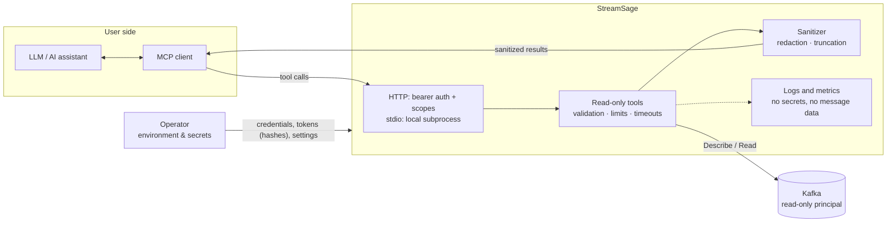
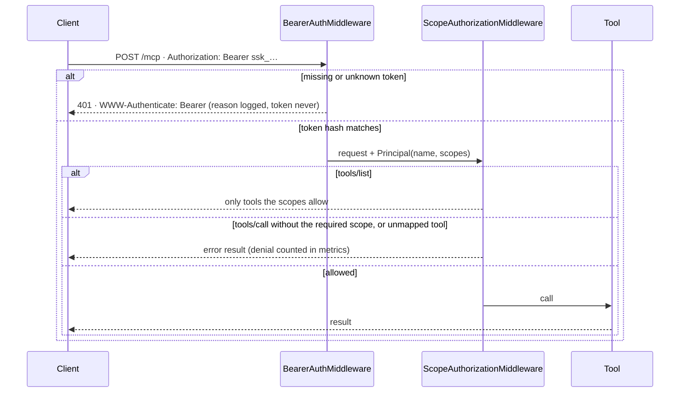

# Security

StreamSage lets an AI assistant look inside Kafka, so it is designed to be
safe to point at real clusters: it never writes, it keeps credentials out of
every output, and it treats message contents as sensitive.

## At a glance

| Area | Protection |
| --- | --- |
| **Kafka access** | Read-only in code (no write APIs are called), and least-privilege ACLs are documented |
| **Credentials** | Taken from the operator's environment only; stored as secrets; never logged, returned or put in errors |
| **HTTP access** | Bearer tokens stored as SHA-256 hashes, constant-time comparison, per-tool scopes, fail-closed authorization |
| **Message data** | Payloads off by default, field-name redaction, size and count limits, binary never decoded, never logged |
| **Inputs** | Typed schemas validate every argument; no input reaches a shell or the file system |
| **Errors** | Short StreamSage messages with Kafka error codes only; no stack traces or raw library output |
| **Supply chain** | Locked dependencies; CI actions pinned to commit SHAs; workflows audited by zizmor |

## Trust boundaries



Everything StreamSage returns may end up in an LLM's context. That is why
sanitization happens *before* results leave the server, and why credentials
and raw library errors never appear in responses.

## Read-only by design

StreamSage never produces messages, creates, deletes or alters topics,
changes offsets, or alters configuration. A contract test checks that no
Kafka adapter exposes a write-style method. Message reads use a consumer
that only `assign()`s explicit offsets: it never subscribes, joins a group or
commits offsets.

Do not rely on the code alone; also restrict the Kafka principal.

## Least privilege

| Resource | Operation | Needed for |
| --- | --- | --- |
| Cluster | `Describe` | Cluster and broker metadata; listing consumer groups |
| Topics | `Describe` | Topic and partition metadata; end offsets for lag |
| Groups | `Describe` | Describing groups and reading committed offsets |
| Topics | `Read` | **Only** `inspect_messages` and `find_messages_by_key`; omit it to disable message reads |

Without `Read`, every tool except the two message tools works
(`list_dlq_topics` only reads offsets). Topics and groups the principal
cannot describe do not appear in results.

Example with Kafka's ACL tool, for a principal `User:streamsage`:

```bash
kafka-acls.sh --bootstrap-server <broker> --command-config admin.properties \
  --add --allow-principal User:streamsage --operation Describe --cluster
kafka-acls.sh --bootstrap-server <broker> --command-config admin.properties \
  --add --allow-principal User:streamsage --operation Describe --topic '*' --group '*'

# Optional, only if message inspection is wanted:
kafka-acls.sh --bootstrap-server <broker> --command-config admin.properties \
  --add --allow-principal User:streamsage --operation Read --topic '*'
```

Narrow `--topic '*'` to specific topics or prefixes
(`--resource-pattern-type prefixed`) where possible.

> **Note:** message reads use a fixed `group.id`,
> `streamsage-inspector-readonly`, because librdkafka requires one. The group
> is never joined and does not appear on the cluster; the integration tests
> check this on every CI run. This has not been tested against a broker
> enforcing ACLs. If yours requires `Read` on that group, grant it, and
> please report it.

## Credentials

- Credentials come from environment variables, or a local `.env` that is
  never committed. MCP clients cannot pass credentials in tool calls.
- The SASL password is a `SecretStr`. Its value is extracted only when the
  Kafka client configuration is built, and that configuration is never
  logged.
- Invalid configuration stops the server with field names and reasons only,
  never the configured values. That includes unparseable values, such as
  malformed JSON.
- Tests use credentials generated at runtime, so the repository contains no
  credential-like literals.

## Kafka transport (TLS/SASL)

| Protocol | Encrypted | Use |
| --- | --- | --- |
| `PLAINTEXT` | ❌ | Local development only; a warning is logged for non-loopback brokers |
| `SASL_PLAINTEXT` | ❌ (passwords too, with `PLAIN`) | Local development only |
| `SSL` | ✅ | TLS; set `STREAMSAGE_KAFKA_SSL_CA_LOCATION` for a private CA |
| `SASL_SSL` | ✅ | Recommended for remote clusters |

- Supported SASL mechanisms: `PLAIN`, `SCRAM-SHA-256` and `SCRAM-SHA-512`.
  `GSSAPI`, `OAUTHBEARER` and mTLS client certificates are not supported yet.
- SCRAM over `SASL_PLAINTEXT` and `SASL_SSL` is tested against a real broker
  (`tests/security`, see [development.md](development.md)).
- `STREAMSAGE_KAFKA_SSL_CA_LOCATION` must point to an existing file. If
  librdkafka rejects the security configuration, the server exits with
  code 2 and only the error code.
- A wrong password is reported as "Authentication with the Kafka cluster
  failed", and an untrusted certificate as "TLS handshake … failed". Neither
  includes credentials or raw library output.

## MCP transports

### stdio

The MCP client starts StreamSage as a local subprocess, so whoever can run
that client can use every tool. That matches a single user's own machine.

### Streamable HTTP



- **Tokens** are random (`ssk_` + 256 bits), created by
  `streamsage generate-token`. The server is configured with SHA-256
  hashes only, and compares in constant time against every configured hash.
- **Scopes:** `kafka:metadata` covers metadata, lag, diagnostics, DLQ
  listing and the `kafka://` resources; `kafka:messages` covers the message
  tools. Unmapped tools are denied (fail closed).
- **Safe defaults:** HTTP mode refuses to start without a token, and binds
  to `127.0.0.1`, where the MCP SDK's DNS-rebinding protection applies.
  StreamSage serves plain HTTP: put a TLS-terminating reverse proxy in front
  before exposing it, or a warning is logged.
- **Rotation:** add the new hash, update clients, remove the old entry.
- **Endpoints:** `/healthz` is public and reveals only liveness. `/metrics`
  needs a valid token unless `STREAMSAGE_HTTP_METRICS_PUBLIC=true`. Metrics
  contain tool and operation names and counts, never arguments, topic names,
  keys or message data, and their label values are bounded.

### Inputs and errors

- Every tool argument is validated against a typed schema before any Kafka
  call. Topic names follow Kafka's rules (`[a-zA-Z0-9._-]`, 1–249
  characters), and group ids must be printable.
- No input reaches a shell or a file path.
- Errors are short, StreamSage-authored messages with Kafka error codes,
  never stack traces or raw library output.

## Data protection

`inspect_messages` and `find_messages_by_key` can return message data to the
MCP client, and from there to an LLM. The defaults are conservative:

| Control | Default | Setting |
| --- | --- | --- |
| Payloads returned | **No**; size only | `STREAMSAGE_MESSAGE_PAYLOADS_ENABLED` |
| Keys returned | Yes, truncated to 256 bytes; can be withheld | `STREAMSAGE_MESSAGE_KEYS_ENABLED` |
| Redaction of sensitive JSON fields and headers | Always on | `STREAMSAGE_MESSAGE_SENSITIVE_FIELDS` adds terms |
| Payload preview size | 1 KB, after redaction | `STREAMSAGE_MESSAGE_MAX_PAYLOAD_BYTES` |
| Largest payload decoded or kept in memory | 256 KiB; larger ones are reported as `too_large` with their size | `STREAMSAGE_MESSAGE_MAX_DECODE_BYTES` |
| Messages read per `inspect_messages` call | 10,000 across partitions; only the returned `limit` are kept in memory | `STREAMSAGE_MESSAGE_INSPECT_MAX_READ` |
| Key and header value size | 256 bytes | – |
| Messages per call | 20 by default, 100 maximum | `STREAMSAGE_MESSAGE_DEFAULT_LIMIT`, `STREAMSAGE_MESSAGE_MAX_LIMIT` |
| Key search scan | 1,000 per partition, 10,000 total (hard limit) | `STREAMSAGE_MESSAGE_KEY_SEARCH_MAX_*` |
| Binary content (Avro, Protobuf, …) | Never decoded | – |
| Logging of keys, headers, payloads | Never | – |

How redaction works:

- In JSON payloads, the value of any field whose normalized name contains a
  sensitive term (`password`, `secret`, `token`, `authorization`, `apikey`,
  `credential`, `cookie`, `email`, `phone`, `cpf`, `cnpj`, `ssn`,
  `creditcard`, `cardnumber`, `cvv`, `iban`, …) becomes `[REDACTED]`,
  recursively. A sensitive object is redacted as a whole.
- Header values with such names are withheld too.
- Redaction happens **before** truncation, so a redacted value can never
  reappear in a cut-off preview.
- Each message reports its `payload_treatment` and the redacted paths
  (`redacted_fields`).
- Key search discards non-matching messages as it reads them. Memory is
  therefore bounded by the number of results, not the number of messages
  scanned.

### Known limits

| Limit | Mitigation |
| --- | --- |
| Redaction relies on **field names**: a secret under an innocuous name (`"note": "my password is …"`) is not detected | Keep payloads disabled, or add field names with `STREAMSAGE_MESSAGE_SENSITIVE_FIELDS` |
| Non-JSON text payloads (`text_truncated`) are truncated, not redacted | Keep payloads disabled for topics with free text |
| Keys and non-sensitive header values are returned as metadata | Set `STREAMSAGE_MESSAGE_KEYS_ENABLED=false` for keys; add header names to `STREAMSAGE_MESSAGE_SENSITIVE_FIELDS`; or do not grant `Read` |

## Reporting a vulnerability

Please do not open a public issue for security problems. Use GitHub's
private vulnerability reporting on the repository (**Security → Report a
vulnerability**), with steps to reproduce.
