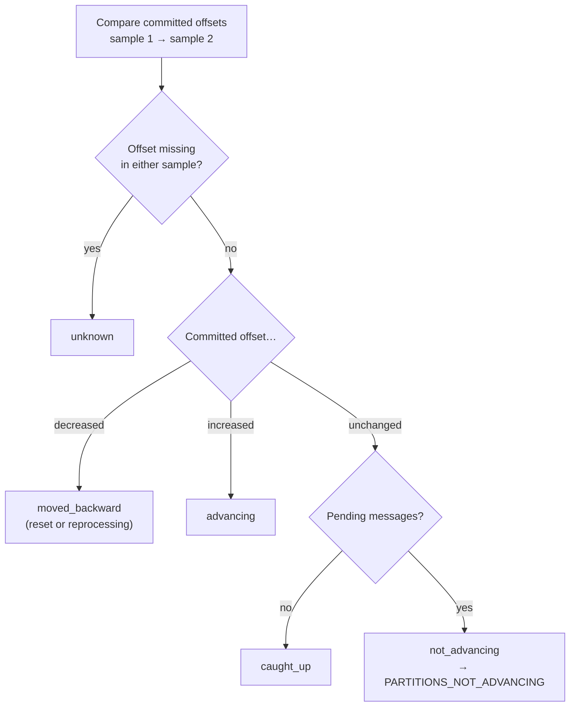

# Tool reference

StreamSage exposes **11 tools**, **2 resources** and **1 prompt**. Every tool
is read-only (MCP annotation `readOnlyHint: true`) and returns structured
JSON with a published output schema.

> **About the examples:** every response below is real output from the
> [sample environment](getting-started.md#what-the-sample-environment-contains),
> with payloads enabled and `STREAMSAGE_DLQ_TOPICS='*.DLQ'`. Long lists are
> shortened with `…`; generated ids are replaced with placeholders.

| Tool | Purpose | HTTP scope |
| --- | --- | --- |
| [`get_cluster_info`](#get_cluster_info) | Cluster id, brokers, controller | `kafka:metadata` |
| [`list_topics`](#list_topics) | Topics with partition count and replication factor | `kafka:metadata` |
| [`describe_topic`](#describe_topic) | Partitions, leaders, replicas, ISR | `kafka:metadata` |
| [`list_consumer_groups`](#list_consumer_groups) | Groups and their state | `kafka:metadata` |
| [`describe_consumer_group`](#describe_consumer_group) | Members and partition assignments | `kafka:metadata` |
| [`get_consumer_lag`](#get_consumer_lag) | Per-partition lag, largest first | `kafka:metadata` |
| [`analyze_consumer_health`](#analyze_consumer_health) | Evidence-based health classification | `kafka:metadata` |
| [`detect_stalled_partitions`](#detect_stalled_partitions) | Progress over a sampling window | `kafka:metadata` |
| [`list_dlq_topics`](#list_dlq_topics) | Configured dead letter queues | `kafka:metadata` |
| [`inspect_messages`](#inspect_messages) | Bounded, sanitized message reads | `kafka:messages` |
| [`find_messages_by_key`](#find_messages_by_key) | Newest messages with an exact key | `kafka:messages` |

Scopes only apply to the [HTTP transport](clients.md#http-mode-shared-server);
over stdio every tool is available.

**Errors** are returned as MCP tool errors with a short, safe message, for
example `Topic 'x' does not exist.`, `Consumer group 'x' does not exist.`,
`Could not connect to the Kafka cluster …` or
`Authentication with the Kafka cluster failed …`. They never contain stack
traces, credentials or raw library output. Invalid arguments are rejected
by the input schema before any Kafka call.

---

## Cluster

### `get_cluster_info`

Cluster id, brokers and controller from one metadata snapshot.

**Parameters:** none.

```json
{
  "cluster_id": "streamsage-local-kraft-01",
  "controller_id": 1,
  "broker_count": 1,
  "brokers": [
    {
      "broker_id": 1,
      "host": "localhost",
      "port": 9092
    }
  ]
}
```

| Field | Notes |
| --- | --- |
| `cluster_id` | `null` if the cluster does not report one |
| `controller_id` | In KRaft mode, Kafka reports a live broker id here, not the active quorum controller |

### `list_topics`

Topics sorted by name. Internal topics (`__*`) are hidden unless requested.

| Parameter | Type | Default | Notes |
| --- | --- | --- | --- |
| `include_internal` | boolean | `false` (server setting `STREAMSAGE_INCLUDE_INTERNAL_TOPICS`) | Include `__consumer_offsets` and other internal topics |

```json
{
  "include_internal": false,
  "topic_count": 5,
  "topics": [
    {
      "name": "customers.updated",
      "internal": false,
      "partition_count": 1,
      "replication_factor": 1,
      "metadata_error": null
    },
    {
      "name": "inventory.updated",
      "internal": false,
      "partition_count": 1,
      "replication_factor": 1,
      "metadata_error": null
    },
    …
  ]
}
```

### `describe_topic`

Every partition with its leader, replicas and in-sync replicas. It uses the
DescribeTopics API, so it **never creates** a missing topic, even when the
broker allows auto-creation.

| Parameter | Type | Constraints |
| --- | --- | --- |
| `topic_name` | string | Required; 1–249 chars of `[a-zA-Z0-9._-]` |

```json
{
  "name": "orders.created",
  "internal": false,
  "partition_count": 3,
  "replication_factor": 1,
  "under_replicated_partition_count": 0,
  "leaderless_partition_count": 0,
  "metadata_error": null,
  "partitions": [
    {
      "partition_id": 0,
      "leader": 1,
      "replicas": [
        1
      ],
      "isr": [
        1
      ],
      "under_replicated": false,
      "metadata_error": null
    },
    …
  ]
}
```

| Field | Meaning |
| --- | --- |
| `leader` | Leader broker id; `null` means the partition is offline |
| `under_replicated` | Fewer in-sync replicas than assigned replicas |
| `under_replicated_partition_count` / `leaderless_partition_count` | Totals for quick triage |

---

## Consumers

### `list_consumer_groups`

| Parameter | Type | Default | Notes |
| --- | --- | --- | --- |
| `states` | list of `stable`, `empty`, `preparing_rebalance`, `completing_rebalance`, `dead`, `unknown` | all | Filter by state |

```json
{
  "group_count": 3,
  "complete": true,
  "failed_broker_count": 0,
  "failure_codes": [],
  "notes": [],
  "groups": [
    {
      "group_id": "inventory-service",
      "state": "stable",
      "is_simple": false
    },
    {
      "group_id": "orders-service",
      "state": "empty",
      "is_simple": true
    },
    {
      "group_id": "payments-service",
      "state": "empty",
      "is_simple": true
    }
  ]
}
```

`is_simple` is `true` for groups that only hold committed offsets and never
ran the group protocol (for example, offsets set by tooling).

Kafka lists groups by asking every broker. If some brokers fail to answer,
the groups that were returned are still listed, but the result has
`complete: false`, the number of brokers that failed, their Kafka error
codes, and a note: a group missing from an incomplete listing may still
exist. Check a specific group with `describe_consumer_group`. If no broker
answers, the call fails.

### `describe_consumer_group`

| Parameter | Type | Constraints |
| --- | --- | --- |
| `group_id` | string | Required; 1–255 printable characters |

```json
{
  "group_id": "inventory-service",
  "state": "stable",
  "is_simple": false,
  "partition_assignor": "range",
  "coordinator_id": 1,
  "member_count": 1,
  "members": [
    {
      "member_id": "inventory-service-1-<generated>",
      "client_id": "inventory-service-1",
      "host": "/<consumer ip>",
      "group_instance_id": null,
      "assignment": [
        {
          "topic": "inventory.updated",
          "partition": 0
        }
      ]
    }
  ]
}
```

A group id Kafka does not know is reported as
`Consumer group '…' does not exist.`. Kafka itself answers with an empty
`DEAD` group rather than an error.

### `get_consumer_lag`

Lag = log end offset − committed offset, for every partition the group has
committed **or** is assigned. Largest lag first.

| Parameter | Type | Default | Constraints |
| --- | --- | --- | --- |
| `group_id` | string | – | Required |
| `max_partitions` | integer | `100` | 1–1000; totals always cover every partition |

```json
{
  "group_id": "orders-service",
  "total_lag": 180,
  "max_lag": 66,
  "partition_count": 3,
  "unknown_lag_partition_count": 0,
  "truncated": false,
  "partitions": [
    {
      "topic": "orders.created",
      "partition": 2,
      "committed_offset": 40,
      "log_end_offset": 106,
      "lag": 66
    },
    {
      "topic": "orders.created",
      "partition": 1,
      "committed_offset": 40,
      "log_end_offset": 100,
      "lag": 60
    },
    {
      "topic": "orders.created",
      "partition": 0,
      "committed_offset": 40,
      "log_end_offset": 94,
      "lag": 54
    }
  ]
}
```

| Rule | Detail |
| --- | --- |
| Unknown is not zero | A missing committed or end offset gives `lag: null`; `total_lag` sums known values and `unknown_lag_partition_count` reports the rest |
| End offset | High watermark (read_uncommitted); transactional consumers may see a slight overestimate |
| Snapshot | Lag says how far behind, not whether the group is progressing; use `detect_stalled_partitions` |

---

## Diagnostics

### `analyze_consumer_health`

Classifies a group as `healthy`, `warning`, `critical` or `unknown`, from its
state, members and current lag.

| Parameter | Type | Constraints |
| --- | --- | --- |
| `group_id` | string | Required |

```json
{
  "group_id": "orders-service",
  "status": "warning",
  "state": "empty",
  "member_count": 0,
  "total_lag": 180,
  "max_lag": 66,
  "thresholds": {
    "warning": 1000,
    "critical": 10000
  },
  "findings": [
    {
      "code": "NO_ACTIVE_MEMBERS",
      "severity": "warning",
      "summary": "The group has no active members while 180 message(s) are pending, so nothing in this group is consuming them.",
      "evidence": [
        {
          "label": "state",
          "value": "empty"
        },
        {
          "label": "member_count",
          "value": 0
        },
        {
          "label": "total_lag",
          "value": 180
        }
      ],
      "hypotheses": [
        "The consuming application may be stopped or unable to join the group.",
        "The group may be obsolete and no longer used."
      ],
      "recommendations": [
        "Check whether the consuming application is running and can reach the cluster."
      ]
    }
  ],
  "limitations": [
    "Based on a single snapshot: it shows how far behind the group is, not whether its offsets are advancing. A large lag can belong to a healthy consumer catching up. Use detect_stalled_partitions to compare offsets over time.",
    "Lag thresholds are configured values (warning >= 1000, critical >= 10000 messages per partition), not derived from this consumer's throughput."
  ]
}
```

Findings it can produce:

| Code | Default severity | Condition |
| --- | --- | --- |
| `LAG_ABOVE_CRITICAL` | critical | A partition's lag ≥ `STREAMSAGE_LAG_CRITICAL_THRESHOLD` (default 10,000) |
| `LAG_ABOVE_WARNING` | warning | A partition's lag ≥ `STREAMSAGE_LAG_WARNING_THRESHOLD` (default 1,000) |
| `NO_ACTIVE_MEMBERS` | warning | No members while messages are pending |
| `REBALANCING` | warning | Group is preparing or completing a rebalance |
| `UNASSIGNED_PARTITIONS_WITH_LAG` | warning | Members exist, but partitions with lag are assigned to none |
| `INACTIVE_CAUGHT_UP` | info | No members, nothing pending |
| `LAG_UNKNOWN` | info | Some partitions have unknown lag |
| `NO_PARTITIONS` | info | No committed offsets and no assignments |
| `STATE_UNKNOWN` | info | Coordinator reported no known state |

The status is the worst severity found. With no warning or critical finding,
it is `unknown` when no lag could be determined, and `healthy` otherwise.
Severities can be overridden per code with
`STREAMSAGE_FINDING_SEVERITY_OVERRIDES`
([configuration.md](configuration.md#diagnostics)).

### `detect_stalled_partitions`

Samples the group's offsets twice, `interval_seconds` apart, **within one
call**, and classifies each partition. The call takes at least
`interval_seconds`.

| Parameter | Type | Default | Constraints |
| --- | --- | --- | --- |
| `group_id` | string | – | Required |
| `interval_seconds` | integer | `10` | 1–60 |
| `max_partitions` | integer | `100` | 1–1000 |



```json
{
  "group_id": "orders-service",
  "status": "warning",
  "state": "empty",
  "member_count": 0,
  "interval_seconds": 5.0,
  "partition_counts": {
    "advancing": 0,
    "caught_up": 0,
    "not_advancing": 3,
    "moved_backward": 0,
    "unknown": 0
  },
  "truncated": false,
  "partitions": [
    {
      "topic": "orders.created",
      "partition": 2,
      "status": "not_advancing",
      "committed_before": 40,
      "committed_after": 40,
      "committed_delta": 0,
      "new_messages": 0,
      "lag_after": 66
    },
    …
  ],
  "findings": [
    {
      "code": "PARTITIONS_NOT_ADVANCING",
      "severity": "warning",
      "summary": "3 partition(s) had pending messages and their committed offset did not change during the 5s sampling window; 0 of them received new messages meanwhile.",
      "evidence": [
        {
          "label": "member_count",
          "value": 0
        },
        {
          "label": "backlog_growing_partitions",
          "value": 0
        },
        {
          "label": "orders.created[2].lag",
          "value": 66
        },
        {
          "label": "orders.created[2].new_messages",
          "value": 0
        },
        …
      ],
      "hypotheses": [
        "The group has no active members to consume them.",
        "The consumer may be blocked on, or repeatedly failing to process, a message in these partitions.",
        "The consumer may commit less often than every 5s."
      ],
      "recommendations": [
        "Sample again with a longer interval to rule out infrequent commits.",
        "Check the consumer application's logs for errors on these partitions."
      ]
    }
  ],
  "limitations": [
    "Covers only the 5s between two samples; it says nothing about what happened before or after.",
    "Uses committed offsets, not the consumers' in-memory position. A consumer that commits less often than the sampling interval can look stalled; a longer interval reduces that risk."
  ]
}
```

Findings: `PARTITIONS_NOT_ADVANCING` (warning), `COMMITTED_OFFSET_MOVED_BACKWARD`
(info), `PROGRESS_UNKNOWN` (info), `NO_PARTITIONS_SAMPLED` (info). A consumer
that commits less often than the interval can look stalled; the finding and
the limitations say so, so sample again with a longer interval before
concluding.

---

## Messages

Message tools require `Read` permission on the topics in Kafka. They never
join a consumer group or commit offsets. Responses are sanitized according to
the [data protection rules](security.md#data-protection).

| `payload_treatment` | Meaning |
| --- | --- |
| `omitted` | Payloads are disabled (`STREAMSAGE_MESSAGE_PAYLOADS_ENABLED=false`, the default); only the size is shown |
| `json_redacted` | JSON with sensitive fields replaced by `[REDACTED]`, then truncated |
| `text_truncated` | Not JSON: truncated only (field-name redaction cannot apply) |
| `binary` | Not UTF-8 (Avro, Protobuf, …): not decoded |
| `too_large` | Above `STREAMSAGE_MESSAGE_MAX_DECODE_BYTES` (256 KiB by default): neither kept in memory nor decoded; only the size is shown |
| `null` | No payload (for example a tombstone) |

Keys are returned by default. With `STREAMSAGE_MESSAGE_KEYS_ENABLED=false`,
every message has `key: null` and `key_withheld: true`; the key's size and
encoding are still reported. `find_messages_by_key` keeps working, since the
caller already knows the key being searched for.

### `inspect_messages`

Without `start_offset`: the newest messages, newest first. With `partition`
and `start_offset`: up to `limit` messages from that offset, in offset order.

`limit` bounds the **output**. A separate read budget,
`STREAMSAGE_MESSAGE_INSPECT_MAX_READ` (10,000 by default), bounds how many
messages may be **read**. The globally newest `limit` messages can sit in any
partition, so an exact answer needs the newest `limit` messages of every
partition:

| Situation | Reads | `exact` |
| --- | --- | --- |
| `partitions × limit ≤ budget` | The newest `limit` of each partition | `true`: guaranteed newest |
| Over budget | Fewer per partition (budget ÷ partitions) | `false`: newest *among those read*, explained in `notes` |
| More partitions than the budget | One message from the first partitions | `false`, with the uncovered partitions in `notes` |
| Some partition offsets unavailable | The available partitions | `false`, with the unavailable partitions in `notes` |

Only the `limit` newest messages are held in memory while reading, however
many are read (`messages_read`).

| Parameter | Type | Default | Constraints |
| --- | --- | --- | --- |
| `topic_name` | string | – | Required |
| `limit` | integer | `20` (`STREAMSAGE_MESSAGE_DEFAULT_LIMIT`) | 1 – `STREAMSAGE_MESSAGE_MAX_LIMIT` (100) |
| `partition` | integer | all | ≥ 0 |
| `start_offset` | integer | – | ≥ 0; requires `partition` |

Reading `customers.updated` (fake personal data) from offset 0:

```json
{
  "topic": "customers.updated",
  "payloads_included": true,
  "max_payload_bytes": 1024,
  "message_count": 1,
  "complete": true,
  "exact": true,
  "messages_read": 1,
  "notes": [],
  "messages": [
    {
      "partition": 0,
      "offset": 0,
      "timestamp": "2026-11-22T22:19:05+00:00",
      "timestamp_type": "create_time",
      "key": "cust-1",
      "key_size": 6,
      "key_encoding": "text",
      "key_truncated": false,
      "key_withheld": false,
      "headers": [
        {
          "key": "Authorization",
          "value": "[REDACTED]",
          "value_size": 27,
          "encoding": "text",
          "redacted": true,
          "truncated": false
        },
        {
          "key": "trace-id",
          "value": "abc-001",
          "value_size": 7,
          "encoding": "text",
          "redacted": false,
          "truncated": false
        }
      ],
      "payload_size": 134,
      "payload_treatment": "json_redacted",
      "payload_preview": "{\"id\":1,\"name\":\"Ana\",\"email\":\"[REDACTED]\",\"password\":\"[REDACTED]\",\"address\":{\"city\":\"Recife\",\"phone\":\"[REDACTED]\"}}",
      "payload_truncated": false,
      "redacted_fields": [
        "email",
        "password",
        "address.phone"
      ]
    }
  ]
}
```

Headers of a message in `orders.created.DLQ`. Error details are often in
headers, so they are useful even with payloads disabled:

```json
[
  {
    "key": "error.class",
    "value": "DeserializationException",
    "value_size": 24,
    "encoding": "text",
    "redacted": false,
    "truncated": false
  },
  {
    "key": "error.message",
    "value": "unexpected end of input",
    "value_size": 23,
    "encoding": "text",
    "redacted": false,
    "truncated": false
  },
  {
    "key": "original.offset",
    "value": "42",
    "value_size": 2,
    "encoding": "text",
    "redacted": false,
    "truncated": false
  }
]
```

Retention gaps, empty partitions and offsets beyond the end are reported in
`notes`. A read that hits the timeout returns `complete: false`.

### `find_messages_by_key`

Kafka has no index by key, so this tool scans the **newest** messages of each
partition within budgets, and reports exactly what it covered.

| Parameter | Type | Default | Constraints |
| --- | --- | --- | --- |
| `topic_name` | string | – | Required |
| `key` | string | – | Required; exact match on the UTF-8 key, up to 1024 bytes |
| `limit` | integer | `20` | Maximum matches, newest first |
| `partition` | integer | all | Only search this partition |

```json
{
  "topic": "orders.created",
  "match_count": 1,
  "scanned": 300,
  "searched_whole_topic": true,
  "per_partition_limit": 1000,
  "complete": true,
  "payloads_included": true,
  "coverage": [
    {
      "partition": 0,
      "from_offset": 0,
      "to_offset": 94,
      "scanned_count": 94,
      "reaches_start": true
    },
    …
  ],
  "uncovered_partitions": [],
  "unavailable_partitions": [],
  "notes": [],
  "matches": [
    {
      "partition": 0,
      "offset": 91,
      "timestamp": "2026-11-22T22:18:56+00:00",
      "timestamp_type": "create_time",
      "key": "key-288",
      "key_size": 7,
      "key_encoding": "text",
      "key_truncated": false,
      "key_withheld": false,
      "headers": [],
      "payload_size": 11,
      "payload_treatment": "json_redacted",
      "payload_preview": "{\"seq\":288}",
      "payload_truncated": false,
      "redacted_fields": []
    }
  ]
}
```

| Field | Meaning |
| --- | --- |
| `scanned` | Messages read, matching or not |
| `per_partition_limit` | Budget per partition: `min(STREAMSAGE_MESSAGE_KEY_SEARCH_MAX_PER_PARTITION, MAX_TOTAL ÷ non-empty partitions)`, at least 1 |
| `coverage[].reaches_start` | The scan reached the oldest message still in the partition |
| `uncovered_partitions` | Partitions not searched at all, because the topic has more non-empty partitions than `STREAMSAGE_MESSAGE_KEY_SEARCH_MAX_TOTAL`. The first partitions by id are searched, one message each |
| `unavailable_partitions` | Partitions whose offsets could not be read |
| `searched_whole_topic` | Every partition fully covered; only then does "no match" mean the key is absent |

`STREAMSAGE_MESSAGE_KEY_SEARCH_MAX_TOTAL` is a hard limit: a call never
plans to read more messages than that. Empty partitions do not use any of
the budget. To cover uncovered partitions, search them one at a time with
`partition`.

### `list_dlq_topics`

Topics matching `STREAMSAGE_DLQ_TOPICS` (exact names or glob patterns),
largest first, capped at 50 topics. **Parameters:** none.

```json
{
  "configured": true,
  "patterns": [
    "*.DLQ"
  ],
  "topics": [
    {
      "name": "orders.created.DLQ",
      "partition_count": 1,
      "message_count": 2
    }
  ],
  "notes": []
}
```

Without `STREAMSAGE_DLQ_TOPICS`, it returns `configured: false` with a note:
StreamSage assumes no DLQ naming convention. `message_count` is an upper bound
from offsets, since compaction can leave gaps.

---

## Resources

| URI | Content | HTTP scope |
| --- | --- | --- |
| `kafka://cluster/info` | Same as `get_cluster_info` (JSON) | `kafka:metadata` |
| `kafka://topics` | Same as `list_topics`, using the server's internal-topics setting (JSON) | `kafka:metadata` |

`kafka://cluster/info` on the sample environment:

```json
{
  "cluster_id": "streamsage-local-kraft-01",
  "controller_id": 1,
  "broker_count": 1,
  "brokers": [
    {
      "broker_id": 1,
      "host": "localhost",
      "port": 9092
    }
  ]
}
```

## Prompt

### `investigate_kafka_cluster`

| Argument | Required | Notes |
| --- | --- | --- |
| `focus_topic` | no | A topic to investigate in more depth |

The prompt guides the assistant through:

1. cluster and topics;
2. partitions;
3. consumer health, with `detect_stalled_partitions` when lag is high;
4. a report with **Observed** facts separate from **Hypotheses**.

It tells the assistant never to present a hypothesis as the root cause, and
never to claim the cluster is fully healthy from this data alone.
