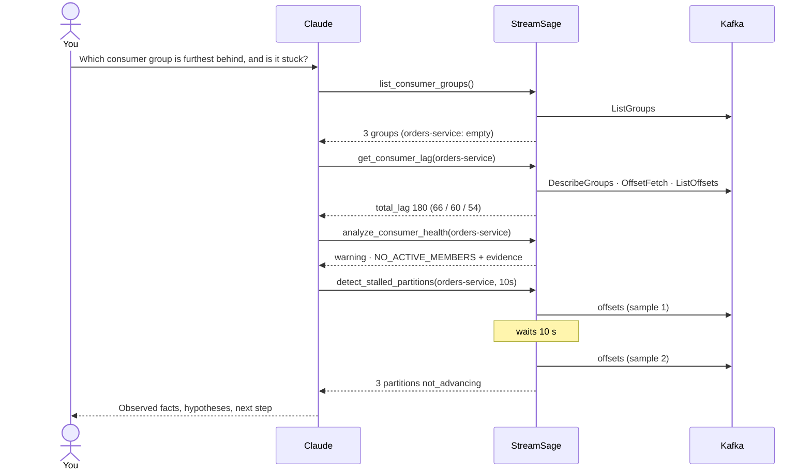
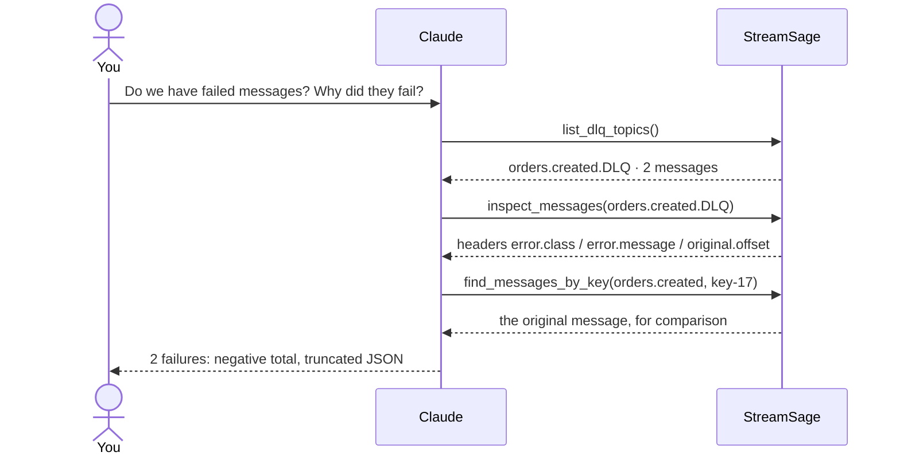

# Usage and example questions

You do not call StreamSage's tools yourself: you ask your AI assistant a
question in plain language, and it decides which tools to call and how to
combine the results. This page lists questions that work well, grouped by
scenario. Each one shows the tools it typically triggers and the answer on
the [sample environment](getting-started.md#what-the-sample-environment-contains).

> **Setup assumed:** the sample environment (`make kafka-up`) and a client
> configured with `STREAMSAGE_DLQ_TOPICS='*.DLQ'` and
> `STREAMSAGE_MESSAGE_PAYLOADS_ENABLED=true`
> ([clients.md](clients.md)). With your own cluster, the questions are the
> same; only the answers differ.

## Example questions

### Exploring the cluster

| Ask | Tools | Sample answer |
| --- | --- | --- |
| "Give me an overview of this Kafka cluster." | `get_cluster_info`, `list_topics` | Cluster `streamsage-local-kraft-01`, 1 broker (`localhost:9092`), 5 topics |
| "What topics exist, and how many partitions does each have?" | `list_topics` | `orders.created` 3, `payments.processed` 2, the other three 1 each |
| "Include internal topics too." | `list_topics` (`include_internal: true`) | Adds `__consumer_offsets` |
| "Describe the `orders.created` topic." | `describe_topic` | 3 partitions, all led by broker 1, replicas `[1]`, ISR `[1]` |
| "Is any partition under-replicated or without a leader?" | `list_topics`, `describe_topic` | None in the sample cluster |

### Consumer groups and lag

| Ask | Tools | Sample answer |
| --- | --- | --- |
| "Which consumer groups exist and what state are they in?" | `list_consumer_groups` | `inventory-service` stable; `orders-service` and `payments-service` empty |
| "Which consumer groups are furthest behind?" | `list_consumer_groups`, `get_consumer_lag` | `orders-service`: 180 offsets behind; the others: 0 |
| "Show the lag of `orders-service` per partition." | `get_consumer_lag` | Partition 2: 66, partition 1: 60, partition 0: 54 |
| "Which partitions are accumulating the most messages?" | `get_consumer_lag` | `orders.created` partition 2 (66 offsets behind) |
| "Who is consuming `inventory.updated`?" | `list_consumer_groups`, `describe_consumer_group` | `inventory-service`, 1 member (`inventory-service-1`) assigned partition 0 |
| "Only show groups that are stable." | `list_consumer_groups` (`states: ["stable"]`) | `inventory-service` |

### Health and diagnostics

| Ask | Tools | Sample answer |
| --- | --- | --- |
| "Is `orders-service` healthy?" | `analyze_consumer_health` | `warning`: `NO_ACTIVE_MEMBERS` (no members while 180 offsets behind) |
| "Is `orders-service` stuck, or just slow?" | `detect_stalled_partitions` | All 3 partitions `not_advancing` over the sampling window |
| "Check `inventory-service` for problems." | `analyze_consumer_health`, `detect_stalled_partitions` | `healthy`: one member, no lag |
| "Check the health of every consumer group." | `list_consumer_groups`, then `analyze_consumer_health` per group | One `warning` (`orders-service`), two `healthy` |
| "Sample for 30 seconds to rule out slow commits." | `detect_stalled_partitions` (`interval_seconds: 30`) | Same verdict, with more confidence |

### Messages and dead letter queues

| Ask | Tools | Sample answer |
| --- | --- | --- |
| "Do we have dead letter queues with messages?" | `list_dlq_topics` | `orders.created.DLQ`: 2 messages |
| "Why did the messages in the DLQ fail?" | `inspect_messages` | `InvalidOrderException: order total is negative` and `DeserializationException: unexpected end of input` (from the headers) |
| "Show the latest 5 messages in `orders.created`." | `inspect_messages` | Keys such as `key-300`, sizes, timestamps; payloads like `{"seq":300}` |
| "Read `customers.updated` from offset 0." | `inspect_messages` (`partition: 0`, `start_offset: 0`) | 3 messages; `email`, `password`, `phone`, `card_number`, `api_token` redacted |
| "Find the message with key `key-288`." | `find_messages_by_key` | Partition 0, offset 91; whole topic scanned |
| "Is there any message with key `customer-999`?" | `find_messages_by_key` | No match, and the whole topic was scanned. On a large topic it would say which ranges it covered |

### Open-ended investigations

These questions let the assistant chain several tools:

- "Investigate the Kafka cluster and tell me if anything needs attention."
- "Something is wrong with order processing. Investigate `orders.created`."
- "Why is `orders-service` behind? What should I check first?"
- "Write a short incident summary of the current state of our consumers."

You can also use the built-in **`investigate_kafka_cluster` prompt**, with
an optional `focus_topic`. In Claude Code, prompts appear as slash commands
(type `/` and look for `streamsage`). The prompt asks the assistant to:

1. read the cluster and topics;
2. check partitions;
3. analyze consumer health;
4. report **Observed** facts separately from **Hypotheses**;
5. never claim the cluster is fully healthy from metadata alone.

## Walkthrough: "Is orders-service stuck?"

What each step contributes:

| Step | Evidence gained | Why it matters |
| --- | --- | --- |
| `get_consumer_lag` | 180 offsets behind, split per partition | Lag is a single snapshot: it shows *how far* behind, not *why* |
| `analyze_consumer_health` | State `empty`, 0 members | Explains the lag: nobody is consuming |
| `detect_stalled_partitions` | Committed offsets did not move over the window | Confirms no progress, while flagging that infrequent commits could look the same |

A good final answer separates what StreamSage observed from what it
suspects. It also never states a root cause the evidence does not establish.

## Walkthrough: "Why are orders failing?"

Headers often carry the failure reason, so the assistant can explain
failures even with payloads disabled. When payloads are enabled, the
truncated JSON from the deserialization failure (`{"seq":42,"tot`) is
visible as a `text_truncated` preview.

## Tips for better answers

| Tip | Example |
| --- | --- |
| Name the topic or group when you know it | "Check `payments-service`" rather than "check payments" |
| Ask for evidence explicitly | "Show the numbers behind your conclusion." |
| Ask for progress, not just lag, before concluding "stuck" | "Is it stuck, or just behind?" |
| Widen the sampling window for slow committers | "Sample for 30 seconds." |
| Ask for a structured report | "Summarize as Observed / Hypotheses / Next steps." |
| Narrow message reads | "Only partition 2, from offset 90." |

## What StreamSage will not do

| Request | Response |
| --- | --- |
| "Reset the offsets of `orders-service`." | Refused: no tool can write to Kafka. The assistant can only tell you the command to run yourself. |
| "Delete the DLQ" / "create a topic" / "change retention" | Same: read-only by design |
| "Show me the customer's real email address." | Sensitive fields are always redacted, and payloads are off unless the operator enables them |
| "Find this key in the whole history of a huge topic." | Key search scans only the newest messages, within limits, and says exactly what it covered |
| "What is the root cause?" | Findings give evidence and *unverified* hypotheses; the assistant is asked not to claim a cause the data does not show |

See [tools.md](tools.md) for every parameter and complete example responses.
